# CareLink / AlagaQ

## Healthcare Appointment, Queue, and Patient Notification Integration System

**Systems Integration and Architecture — Final Project (Mobile and Web Application Track, Theme 4)**

| Field | Details |
| --- | --- |
| Project title | CareLink / AlagaQ: Healthcare Appointment, Queue, and Patient Notification Integration System |
| Course code | [CTSYSINL] |
| Course name | Systems Integration and Architecture |
| Section | [INF242] |
| Group number | [[Group number]] |
| Members | [[Member 1]], [[Member 2]], [[Member 3]], [[Member 4]], [[Member 5]] |
| Instructor | [[Instructor name]] |
| Submission date | [[Submission date]] |
| Prototype version | 2.0 |

> Fill in every `[[...]]` field before submission. Names, roles, and contributions are intentionally not guessed.

---

## Table of Contents

1. [Introduction](#1-introduction)
2. [Current-State Analysis](#2-current-state-analysis)
3. [Requirements Analysis](#3-requirements-analysis)
4. [Enterprise Architecture](#4-enterprise-architecture)
5. [Target-State Architecture](#5-target-state-architecture)
6. [System Design](#6-system-design)
7. [Integration Design and Implementation](#7-integration-design-and-implementation)
8. [Security, Governance, and Risk Management](#8-security-governance-and-risk-management)
9. [Testing and Evaluation](#9-testing-and-evaluation)
10. [Deployment, Backup, and Recovery](#10-deployment-backup-and-recovery)
11. [System Demonstration Guide](#11-system-demonstration-guide)
12. [Limitations and Future Enhancements](#12-limitations-and-future-enhancements)
13. [Individual Contribution](#13-individual-contribution)
14. [References](#14-references)
15. [Appendices](#15-appendices)

---

## 1. Introduction

### 1.1 Background of the Project

Small outpatient clinics and community health centres usually run the patient visit on several disconnected tools: a paper or spreadsheet appointment list, hand-written queue numbers, paper intake forms carried to the doctor, verbal calls in a crowded waiting area, and phone or text follow-up typed by hand. Each step works on its own, but the hand-offs between them — front desk to doctor, doctor back to front desk, clinic to patient, clinic to the insurer — are where time is lost, records are duplicated, and nobody can say who changed what.

CareLink / AlagaQ is an integrated mobile-friendly web system that connects those steps. A patient gets a queue ticket from a phone (AlagaQ) or books an appointment; clinic staff check the patient in and submit an intake record; a doctor approves, rejects, or requests a revision; the patient is notified by SMS and email; and approved records are exported for PhilHealth processing. Every step is linked to the same patient and visit, and every action is logged.

The project specification is written with creative-production vocabulary (projects, assets, artists, reviewers). The selected theme is healthcare, so this report uses the following equivalents throughout:

| Specification term | CareLink equivalent |
| --- | --- |
| Project / production item | Patient visit (appointment) |
| Task / submission | Consultation intake record |
| Asset / file | Patient file (lab result, prescription, imaging, referral) |
| Version (v1, v2, revised, approved, final) | File version and consultation revision |
| Reviewer / director | Doctor |
| Artist / animator / editor | Clinic staff |
| Client | Patient |
| Project manager / admin | Administrator |
| Production dashboard | Clinic dashboard and operations report |

### 1.2 Problem Statement

The clinic's visit workflow is spread across tools that do not share data. As a result:

- Queue order and patient calls depend on staff memory and shouting names in the waiting area.
- Intake notes reach the doctor on paper; when something is missing the doctor sends them back verbally and there is no record of the request or the correction.
- Lab results and prescriptions are kept as loose files or photos with no version history, so the "latest" copy is unclear.
- Patients are not told when their record is approved or when their number is called unless staff phone them.
- Approved consultations are re-typed into a separate spreadsheet for PhilHealth, which duplicates effort and introduces errors.
- Bulk appointment lists from partner programmes (for example, vaccination drives) arrive as spreadsheets and are typed in by hand.
- There is no audit trail showing who approved, rejected, or changed a record.

The problem is therefore one of **integration**: the data exists, but it does not move reliably between the people and systems that need it.

### 1.3 Project Objectives

**General objective.** To design, build, test, and defend an integrated web and mobile-friendly system that connects patient registration, appointment booking, queue management, clinical intake and review, patient file versioning, patient notification, and claims-data export through a documented architecture, API, event-driven workflow automation, and ETL integrations.

**Specific objectives.**

1. Identify the real-world clinic visit problem and its stakeholders (Sections 1–2).
2. Model the current-state and target-state processes (Sections 2.1 and 5.1).
3. Identify stakeholders, systems, interfaces, and data exchanges (Sections 2.3 and 3.3).
4. Describe the business, data, application, and technology architecture (Section 4).
5. Select and justify an architecture style and integration pattern (Sections 5.3–5.5).
6. Deliver a working integrated prototype with the 12 required screens plus supporting screens (Section 6.6).
7. Implement a REST API, an event bus (messaging), workflow automation, an SMS/email gateway integration, and two ETL flows (Section 7).
8. Apply validation, error handling, role-based access, and record-level security controls (Sections 7.5 and 8).
9. Produce integration logs with transaction IDs, notification logs, and an immutable audit trail (Sections 7.6 and 8.4).
10. Perform functional, integration, error-handling, security, and end-to-end testing (Section 9).
11. Provide backup, recovery, and deployment evidence (Section 10).
12. Present and defend the decisions, limitations, and future enhancements (Sections 5.5, 11, and 12).

### 1.4 Scope and Limitations

**In scope**

- Public mobile-friendly queue registration (AlagaQ) and a live public queue display.
- Sign-in with four roles (Admin, Doctor, Clinic Staff, Patient) and account activation/deactivation.
- Appointment booking, doctor assignment and doctor schedule view, check-in, and queue control (call next, skip, recall, reset).
- Consultation intake, doctor review (approve, reject, request revision), and staff resubmission with revision numbers.
- Patient file upload with categories and version history (uploaded, revised, revision requested, approved/final, rejected).
- Comment and feedback threads on consultations and files.
- Workflow event bus driving in-app alerts and patient SMS/email notifications through a gateway.
- CSV appointment import (ETL with cleaning, validation, duplicate detection) and PhilHealth CSV export (ETL).
- Dashboard, operations report, notification log, integration log, and audit trail.
- Automated test suite, backup and restore tooling.

**Out of scope / limitations**

- No real SMS carrier, email provider, or PhilHealth endpoint is connected. The gateway is a loopback mock, and the PhilHealth layout is a demonstration mapping (Section 12.1).
- No electronic prescribing, billing, payments, or full electronic medical record.
- Single-clinic, single-server deployment on SQLite; no high availability.
- Seeded fictional data only; no real patient information may be used.

### 1.5 Target Users

| User | Role in the system | Main screens |
| --- | --- | --- |
| Public visitor / walk-in patient | Requests a queue ticket from a phone and watches the live display; no account needed | Registration, Queue display |
| Patient | Books own appointments, views own visits, uploads own files, comments on own records, receives SMS/email | Dashboard, Appointments, Files, Feedback, Notifications |
| Clinic Staff | Books and checks in patients, runs the queue terminal, submits intake, answers revision requests, uploads files, imports CSV | Appointments, Queue terminal, Intake, Files, Feedback, Integrations (import), Reports |
| Doctor | Works through an assigned schedule, approves/rejects/requests revisions on consultations and files, comments | Dashboard, Appointments, Doctor review, Files, Feedback, Reports |
| Administrator | Manages accounts, watches integration health, exports PhilHealth data, reviews audit trail and reports | All management screens |

---

## 2. Current-State Analysis

### 2.1 Current-State Process

The current state below is an **analytical baseline** built from typical small-clinic practice; the team should validate it with a clinic stakeholder before presenting it as observed fact.

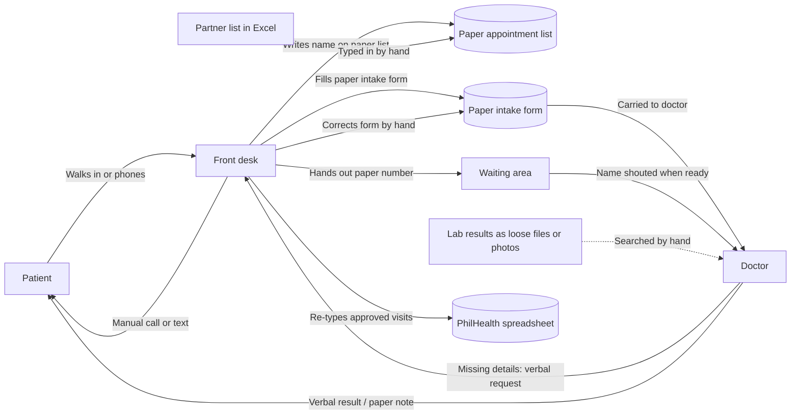

### 2.2 Current-State Problems

| # | Problem | Effect | How CareLink addresses it |
| --- | --- | --- | --- |
| 1 | Manual queue and verbal calls | Crowding, missed turns, disputes over order | Stable ticket numbers, queue terminal, public display, SMS when called |
| 2 | Paper intake carried to the doctor | Delays, lost or illegible forms | Electronic intake linked to the checked-in appointment |
| 3 | Verbal revision requests | No record of what was asked or changed | "Request revision" decision, revision counter, revision notes, comment thread |
| 4 | Scattered, duplicated files | Unclear which lab result is current | File versions with status, current/final marker, download audit |
| 5 | Delayed or forgotten patient follow-up | Patients wait or phone the clinic | Event-driven SMS/email on approval and on queue call |
| 6 | Re-typing for PhilHealth | Duplicate work and transcription errors | One-click ETL export from approved records |
| 7 | Bulk lists typed by hand | Slow, error-prone, duplicates | CSV import with cleaning, validation, duplicate detection |
| 8 | Unclear responsibility | Nobody can show who approved or changed a record | Role-based access, doctor assignment, immutable audit log |
| 9 | No overview | Manager cannot see backlog or overdue work | Dashboard tasks, operations report, overdue and no-show lists |

### 2.3 Stakeholder Analysis

| Stakeholder | Interest | Influence | Key needs | System role |
| --- | --- | --- | --- | --- |
| Patients / public | Short waits, clear status, privacy | Medium | Easy ticket, notifications, access to own records | Patient, public visitor |
| Clinic front-desk staff | Smooth flow, fewer corrections | High (daily users) | Fast booking, queue control, clear revision requests | Clinic Staff |
| Doctors | Complete records, less admin | High | Review queue, request revision instead of chasing paper | Doctor |
| Clinic administrator / owner | Throughput, compliance, accountability | High | Reports, audit trail, account control, export | Admin |
| PhilHealth (external) | Correct, timely claims data | High (external rule-setter) | Data in the agreed format | External data recipient (CSV) |
| SMS / email provider (external) | Valid delivery requests | Low | Well-formed requests | External gateway |
| Partner programmes (e.g., vaccination drives) | Their lists get scheduled | Medium | Bulk import | External CSV source |
| IT support / developers | Maintainable, recoverable system | Medium | Clear modules, logs, backups, tests | Technical owner |
| Data protection officer | Lawful, minimal processing | High | Access control, minimal SMS content, retention | Governance reviewer |

---

## 3. Requirements Analysis

### 3.1 Functional Requirements

| ID | Requirement | Priority | Status |
| --- | --- | --- | --- |
| FR-001 | The system must allow authorized users to sign in with a username, password, and role. | Must | Implemented |
| FR-002 | The system must let the Admin create accounts, link patient accounts to a patient record, and activate or deactivate accounts. | Must | Implemented |
| FR-003 | The system must let staff and patients book appointments, assign a doctor, and allocate a daily queue number automatically. | Must | Implemented |
| FR-004 | The system must let a public visitor request a queue ticket without an account and show a live public queue display. | Must | Implemented |
| FR-005 | The system must let staff call next, skip, recall, and (Admin) reset the daily queue while keeping history. | Must | Implemented |
| FR-006 | The system must let clinic staff submit an intake record linked to a checked-in appointment. | Must | Implemented |
| FR-007 | The system must let a doctor approve, reject, or request a revision of a consultation with a required comment. | Must | Implemented |
| FR-008 | The system must let staff resubmit a consultation after a revision request, incrementing its revision number. | Must | Implemented |
| FR-009 | The system must let users upload patient files (PDF/PNG/JPEG) with a category and keep every version. | Must | Implemented |
| FR-010 | The system must track file version status: uploaded, revised, revision requested, approved (final), rejected. | Must | Implemented |
| FR-011 | The system must store comments, review notes, and revision notes per consultation and per file. | Must | Implemented |
| FR-012 | The system must automatically publish workflow events and notify the right role in-app (new submission, revision request, rejection, booking, patient feedback). | Must | Implemented |
| FR-013 | The system must send the patient an SMS and email through the gateway when a record is approved, and an SMS when their ticket is called. | Must | Implemented |
| FR-014 | The system must record every notification attempt, including failures, in a notification log. | Must | Implemented |
| FR-015 | The system must import appointments from CSV, cleaning and validating each row, skipping duplicates, and reporting rejected rows. | Must | Implemented |
| FR-016 | The system must export approved consultations to the PhilHealth demonstration CSV layout. | Must | Implemented |
| FR-017 | The system must record every integration step with a transaction ID, status, and error message. | Must | Implemented |
| FR-018 | The system must display a role-specific dashboard and an operations report (status counts, doctor workload, overdue reviews, missed appointments, delivery and integration health). | Must | Implemented |
| FR-019 | The system must record audit logs for important actions and prevent their modification. | Must | Implemented |
| FR-020 | The system must show a visit details page combining appointment, intake, review comments, files, queue history, and (Admin) audit entries. | Should | Implemented |

### 3.2 Nonfunctional Requirements

| ID | Requirement | Category | How it is met / verified |
| --- | --- | --- | --- |
| NFR-001 | Only authenticated users can access protected records; tokens expire after 8 hours. | Security | JWT verification on every request; EH-01, SC-01 |
| NFR-002 | Users can only access records they are entitled to: patients their own; doctors their assigned or unassigned visits. | Authorization | Record-level checks in `lib/access.js`; SC-03, SC-05, SC-06 |
| NFR-003 | All approvals, rejections, revision requests, and resubmissions are recorded in an append-only audit log. | Auditability | Audit calls in each route; SQLite triggers; SC-04, E2E-01 |
| NFR-004 | Required fields and formats are validated before data is saved or sent. | Reliability | Server-side validation; EH-03, EH-05, EH-08, EH-09 |
| NFR-005 | Dashboard and reports are readable and usable on desktop and phone (≥ 400 px). | Usability | Responsive layout; screenshots 17 and 19 |
| NFR-006 | Failed submissions return clear, specific error messages. | Error handling | JSON `error` messages shown in forms and toasts; Section 7.5 |
| NFR-007 | A notification failure must not undo the clinical decision that triggered it. | Reliability | Decision committed before events are published; EH-07 |
| NFR-008 | Database, uploaded files, and exports can be backed up and restored with an integrity check. | Availability | `backup.js`; BR-01, BR-02; Section 10 |
| NFR-009 | Every integration step is traceable end-to-end by one transaction ID. | Observability | `integration_logs`; IT-06, IT-08 |
| NFR-010 | Typical API requests complete in under 1 second on the demo workstation. | Performance | Test run: slowest workflow request well under 1 s (see `test-results.txt`) |
| NFR-011 | Code is modular, formatted consistently, and documented for technical review. | Maintainability | Route/service/lib modules; Prettier config; this report |
| NFR-012 | Only fictional data is used; SMS content contains no diagnosis. | Privacy | Seed data uses `.test` addresses; message templates in `workflowSubscribers.js` |

### 3.3 Interface and Data Exchange Requirements

| ID | Source → Target | Data exchanged | Format / protocol | Trigger |
| --- | --- | --- | --- | --- |
| IF-01 | Browser / phone → REST API | Credentials, bookings, intake, reviews, comments, uploads | JSON over HTTP; multipart for files; JWT bearer token | User action |
| IF-02 | Public registration page → REST API | Name, phone, service | JSON over HTTP (no token) | Visitor submits form |
| IF-03 | Public display → REST API | Ticket numbers and services only (no names) | JSON, polled every 2 s | Timer |
| IF-04 | Route modules → Event bus | Workflow event (type, record, patient, comment) | In-process publish/subscribe | After a business transaction commits |
| IF-05 | Event bus → Notification inbox | In-app alert addressed to a role | Row in `notification_logs` | Event subscriber |
| IF-06 | Notifier → SMS gateway | `{ to, message, eventType, recordId, transactionId }` | JSON HTTP POST to `/sms` | Approval or queue-call event |
| IF-07 | Notifier → Email gateway | Same payload, email address as `to` | JSON HTTP POST to `/email` | Approval event |
| IF-08 | Partner CSV → Import ETL → Database | Patient and appointment rows | CSV (RFC 4180) uploaded as JSON text | Staff/Admin import |
| IF-09 | Database → Export ETL → PhilHealth folder | Approved consultation rows | CSV file + `latest.csv` | Admin export |
| IF-10 | All modules → Integration / audit logs | Transaction ID, action, status, error | Rows in `integration_logs`, `audit_logs` | Every integration step / action |

### 3.4 Integration Requirements Traceability Matrix

| Requirement | Stakeholder | System / module | Diagram(s) | Test case(s) |
| --- | --- | --- | --- | --- |
| FR-001 Sign-in | All users | Accounts router, auth middleware | Use-case, Sequence | IT-01, EH-02 |
| FR-002 Account admin | Admin | Accounts router, Users page | Use-case | SC-02, SC-07 |
| FR-003 Booking & queue number | Patient, Staff | Appointments router, `lib/clinic` | Target process, DFD (P1) | FT-05, EH-03 |
| FR-004 Public ticket & display | Public | Queue router, register/display pages | Context, DFD (P1) | FT-03, IT-02 |
| FR-005 Queue control | Staff, Doctor | Queue router, Queue terminal | Target process | IT-02, IT-09 |
| FR-006 Intake | Staff | Consultations router, Intake page | DFD (P2), Sequence | FT-06, EH-04 |
| FR-007 Doctor review | Doctor | Consultations router, Review page | Sequence | IT-03, FT-09, FT-11, EH-05 |
| FR-008 Resubmission | Staff | Consultations router (PUT) | Sequence | FT-11, E2E-01, EH-09 |
| FR-009 File upload | Staff, Patient | Assets router, Files page | DFD (P4) | IT-04, EH-06 |
| FR-010 Version status | Doctor, Staff | Assets router | ERD | FT-08, FT-10, FT-12 |
| FR-011 Comments | All | Comments router, Feedback page | ERD, Use-case | FT-13, EH-09 |
| FR-012 Workflow events | Doctor, Staff | Event bus, workflow subscribers | Application architecture, Sequence | IT-07 |
| FR-013 SMS / email | Patient | Notifier, gateway mock | Context, Sequence, Deployment | IT-03, IT-06, IT-09 |
| FR-014 Notification log | Admin, Patient | `notification_logs`, Notifications page | DFD (P5) | IT-03, EH-07 |
| FR-015 CSV import | Staff, Partner | Integrations router (import) | DFD (P6), Context | IT-08, EH-08 |
| FR-016 PhilHealth export | Admin, PhilHealth | Integrations router (export) | DFD (P7), Context | IT-05, E2E-01 |
| FR-017 Integration log | Admin, IT | `integration_logs`, Integrations page | Application architecture | IT-06, IT-08, EH-07 |
| FR-018 Dashboard & reports | Admin, Doctor, Staff | Accounts (dashboard), Reports router | Use-case | FT-04, FT-15 |
| FR-019 Audit log | Admin, DPO | `audit_logs` + triggers, Audit page | ERD | SC-04, E2E-01 |
| FR-020 Visit details | Staff, Doctor, Admin | Appointments router (`GET /:id`) | Use-case | FT-14, SC-06 |
| NFR-002 Record scope | DPO, Patient | `lib/access.js` | — | SC-03, SC-05, SC-06 |
| NFR-007 Failure isolation | Patient, Doctor | Event bus, notifier | Sequence | EH-07 |
| NFR-008 Backup / restore | Admin, IT | `backup.js` | Deployment | BR-01, BR-02 |

---

## 4. Enterprise Architecture

### 4.1 Business Architecture

| ID | Business process | Actors | Input → Output | Supporting module |
| --- | --- | --- | --- | --- |
| BP-01 | Patient registration and booking | Public, Patient, Staff | Name/phone/service or booking form → appointment with queue number | Queue (public tickets), Appointments |
| BP-02 | Queue management | Staff, Doctor | Waiting list → called / skipped / recalled / completed patients | Queue terminal |
| BP-03 | Clinical intake | Staff | Checked-in visit + symptoms → submitted consultation | Consultations |
| BP-04 | Clinical review and revision | Doctor, Staff | Submitted record → approved / rejected / revision requested → resubmitted | Consultations, Comments |
| BP-05 | Patient document management | Staff, Patient, Doctor | File → versioned file with review status | Assets, Comments |
| BP-06 | Patient and staff notification | System | Workflow event → in-app alert, SMS, email | Event bus, Notifier |
| BP-07 | Claims data export | Admin | Approved consultations → PhilHealth CSV | Integrations (export) |
| BP-08 | Bulk appointment intake | Staff, Partner | Partner CSV → imported / skipped / rejected rows | Integrations (import) |
| BP-09 | Governance and oversight | Admin | Actions and logs → audit trail, reports, account changes | Users, Audit, Reports |

### 4.2 Data Architecture

| Entity | Description | Source of truth | Created / changed by | Owner module |
| --- | --- | --- | --- | --- |
| `patients` | Patient identity and contact details | CareLink DB (public ticket, booking, CSV import) | Queue, Integrations, seed | Accounts / Patients |
| `users` | Accounts, roles, active flag, patient link | CareLink DB | Admin | Accounts |
| `appointments` | Visit, doctor, schedule, ticket number, queue order, status | CareLink DB | Appointments, Queue, Import | Appointments |
| `queue_events` | Check-in, call, skip, recall, reset history | CareLink DB (append-only by convention) | Queue, Appointments | Queue |
| `consultations` | Intake, status, revision, doctor comment, reviewer | CareLink DB | Consultations | Consultations |
| `assets` / `asset_versions` | Logical file, category, current version; each version's metadata and status | CareLink DB (metadata) + `uploads/` (bytes) | Assets | Assets |
| `comments` | Review notes, revision notes, feedback per consultation or file | CareLink DB | Comments, review routes | Comments |
| `notification_logs` | Every in-app alert, SMS, email, and system notice | CareLink DB | Notifier, system events | Notifications |
| `integration_logs` | Every event-bus, gateway, import, and export step with transaction ID | CareLink DB | Event bus, Notifier, Integrations | Integrations |
| `audit_logs` | Immutable record of user and system actions | CareLink DB (triggers block update/delete) | All modules | Governance |
| PhilHealth CSV | Approved consultation extract | Derived (never edited by hand) | Export ETL | Integrations |

### 4.3 Application Architecture

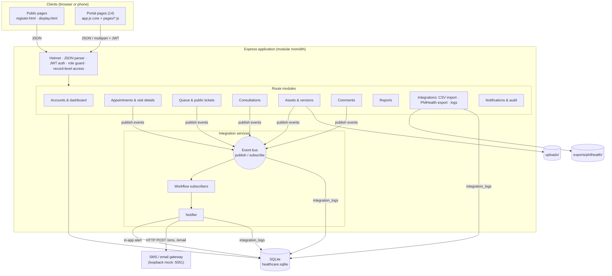

| Application / module | Responsibility | Key interactions |
| --- | --- | --- |
| Public AlagaQ pages | Ticket request and live display for patients on phones | Queue router (no token) |
| Portal pages | Role-based screens; one script per page on a shared core | REST API with JWT |
| Accounts | Login, users, patients, doctors, dashboard counts | All modules (authentication) |
| Appointments | Booking, status transitions, doctor schedule filter, visit details | Queue events, event bus |
| Queue | Public tickets, queue terminal actions, display data | Event bus (`queue.patient_called`) |
| Consultations | Intake, review decisions, resubmission | Comments, event bus |
| Assets | Upload, versioning, review, authenticated download | File storage, comments, event bus |
| Comments | Threads and recent feedback with record-level access | Event bus (`comment.added`) |
| Event bus + subscribers | Decouples "what happened" from "who must be told" | Notifier, integration log |
| Notifier | In-app alerts and gateway delivery; logs every attempt | Gateway, notification and integration logs |
| Integrations | CSV import ETL, PhilHealth export ETL, integration log API | Database, export folder |
| Reports | Aggregated status, workload, delivery, integration, overdue data | Read-only queries |

### 4.4 Technology Architecture

| Layer | Technology | Purpose |
| --- | --- | --- |
| Frontend | HTML5, CSS3, vanilla JavaScript (Fetch API) | Responsive portal and public pages; no build step |
| Mobile | Responsive layout + web app manifest | Installable AlagaQ registration on phones |
| Backend | Node.js ≥ 18.17 (tested on 24.13.1), Express 4 | REST API, routing, middleware |
| Security | `helmet` (HTTP headers), `jsonwebtoken` (JWT), `bcryptjs` (password hashing) | Authentication and hardening |
| File handling | `multer` | Multipart upload, size and type limits |
| Database | SQLite via `better-sqlite3` (WAL mode, foreign keys) | Relational store with transactions and triggers |
| Storage | Local `uploads/` and `exports/philhealth/` folders | File bytes and CSV exports |
| Integration | In-process event bus; HTTP gateway adapter; CSV ETL | Messaging, notifications, batch exchange |
| Notification service | Loopback Express service on port 5051 (`/sms`, `/email`) | Stand-in for a real provider |
| Dashboard / reporting | Reports API + dashboard page | Aggregated operational data |
| Testing | Node.js built-in test runner (`node:test`) | 43 isolated automated tests |
| Tooling | Prettier (`.prettierrc.json`) | Consistent code formatting |

---

## 5. Target-State Architecture

### 5.1 Target-State Process

```mermaid
flowchart LR
  P[Patient / public] -->|Ticket or booking| API[CareLink API]
  CSV[Partner CSV] -->|Import ETL| API
  API --> APPT[(Appointment + queue number)]
  S[Clinic Staff] -->|Check in · intake| API
  API --> C[(Consultation: submitted)]
  C -->|event: consultation.submitted| BUS((Event bus))
  BUS -->|in-app alert| D[Doctor]
  D -->|Approve / Reject / Request revision + comment| API
  API -->|revision_requested| BUS
  BUS -->|in-app alert| S
  S -->|Correct and resubmit (revision +1)| API
  API -->|approved| BUS
  BUS -->|SMS + email| GW[SMS / email gateway]
  GW --> P
  S -->|Call next| API -->|queue.patient_called| BUS
  A[Admin] -->|Export| ETL[PhilHealth CSV]
  API --> LOGS[(Notification · integration · audit logs)]
```

### 5.2 Target-State Architecture Diagram

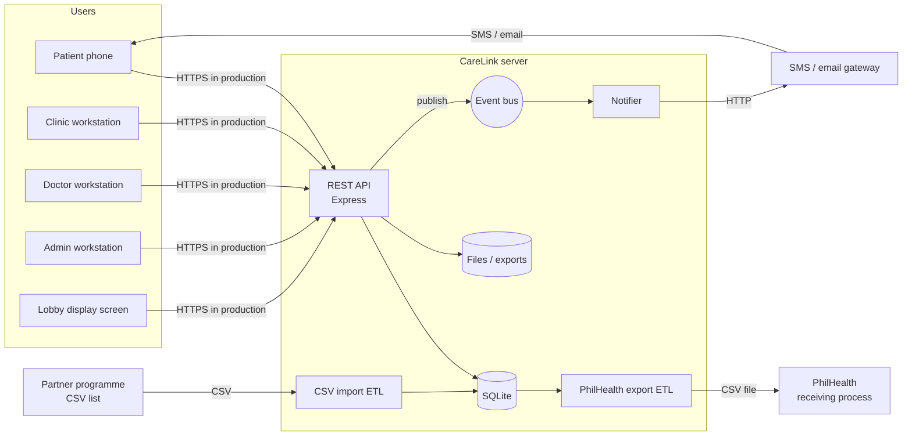

### 5.3 Architecture Style Selection

| Style | Fit for CareLink | Advantages | Drawbacks for this project | Decision |
| --- | --- | --- | --- | --- |
| Layered | Clear UI / business logic / data separation | Simple, familiar, easy to test | Alone, it does not decouple notifications from business code | **Used** as the base structure |
| Service-oriented | Reusable services (appointments, notifications, reports) | Reuse across channels | Needs service contracts and an ESB/broker; heavy for one clinic | Not selected; modules are designed so they could become services |
| Microservices | Separate deployable services | Independent scaling and deployment | Distributed transactions, service discovery, many deployments; excessive for a 5-person prototype | Rejected |
| Event-driven | Workflow actions trigger automatic responses | Loose coupling, easy to add new reactions, natural audit trail | Harder to trace without logging; eventual consistency | **Used** for workflow integration |

**Selected: a layered modular monolith with event-driven integration.** Requests flow through presentation (HTML/JS) → API middleware (authentication, role and record checks) → route modules (business rules, transactions) → data (SQLite, files). Workflow outcomes are published as events to an in-process bus; subscribers decide who is told and how. This keeps one deployable unit — easy to run, back up, and defend — while the event bus shows genuine decoupling: adding a new reaction (for example, a future billing step on `consultation.approved`) means adding a subscriber, not editing the consultation route.

### 5.4 Integration Pattern Selection

| Pattern | How it would look in CareLink | Pros | Cons | Use in CareLink |
| --- | --- | --- | --- | --- |
| Point-to-point | Each route calls the SMS gateway, email gateway, and log directly | Quick to build | Every new channel means editing every route; tangled error handling | Only at the edge: the notifier is the single adapter that calls the gateway |
| Hub-and-spoke | A central hub receives messages and routes them to spokes | One place to route and log | Hub can become a bottleneck / single point of failure | The event bus acts as the hub inside the process |
| Shared database | Modules read and write one database | Simple, transactional, consistent | Risky if ownership is unclear | Used for core records **with explicit table ownership** (Section 4.2, 8.5) |
| Event-driven | Producers publish events; consumers react | Loose coupling, extensible, auditable | Requires tracing; consumers must tolerate failure | **Primary pattern** for workflow notifications and queue calls |
| File-based (batch) ETL | CSV in, CSV out | Matches how partners and PhilHealth exchange data | Not real-time | Used for import and export |

**Selected: event-driven publish/subscribe through an in-process hub, plus batch ETL for external file exchange.** Rationale: (1) the clinic workflow is naturally a chain of events (submitted → revision requested → resubmitted → approved → notified); (2) notification failures must not roll back a clinical decision, which the bus enforces by publishing only after the transaction commits and never throwing back to the caller; (3) every event and every subscriber outcome is logged under one transaction ID, which answers the classic weakness of event-driven systems — traceability; (4) the external partners exchange files, so CSV ETL is the realistic interface.

### 5.5 Architecture Decision Record

| ADR | Decision | Context | Rationale | Consequences |
| --- | --- | --- | --- | --- |
| ADR-001 | Modular monolith (Express routers + services) | One clinic, five-person team, local demo | Clear module seams without distributed-system overhead | One process to scale; modules can be split later along existing seams |
| ADR-002 | In-process event bus for workflow reactions | Notifications were previously called directly from routes | Decouples producers from consumers; one place lists all reactions (`workflowSubscribers.js`) | Events are not persisted for replay; a production version should use a durable broker or outbox table |
| ADR-003 | SQLite with WAL and foreign keys | Single workstation, reproducible tests | Zero-install, transactional, supports triggers and online backup | Not suitable for many concurrent writers or multiple servers |
| ADR-004 | JWT + server-side role guard + record-level checks | Four roles, patient privacy | UI hiding is not security; every API call is re-checked, including doctor assignment and patient ownership | Tokens are valid for 8 h; deactivation takes effect immediately because each request reloads the user |
| ADR-005 | Gateway adapter to a loopback SMS/email mock | No carrier account for a class project | Proves a real HTTP request/response boundary, success and failure handling | No real delivery; a provider adapter must be written for production |
| ADR-006 | CSV ETL for partner import and PhilHealth export | Partners and insurer exchange spreadsheets | Matches real practice; validation and per-row results are visible and testable | PhilHealth layout is illustrative and must be replaced with the official specification |
| ADR-007 | Append-only audit enforced by SQLite triggers | Accountability requirement | Blocks ordinary UPDATE/DELETE even outside the API | A database administrator could still drop triggers; production should ship logs to separate WORM storage |
| ADR-008 | Commit first, then publish; bus never rejects | Approval must survive gateway outages | Clinical record integrity outranks notification delivery | Failed notifications need manual follow-up or a future retry queue (Section 12.2) |

---

## 6. System Design

### 6.1 Use-Case Diagram

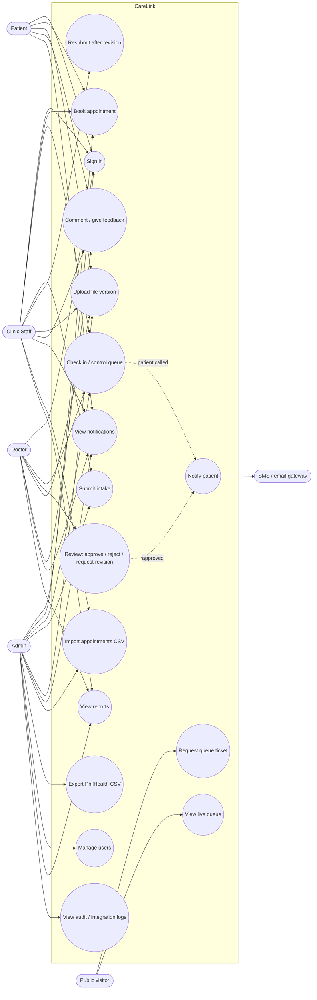

### 6.2 Context Diagram

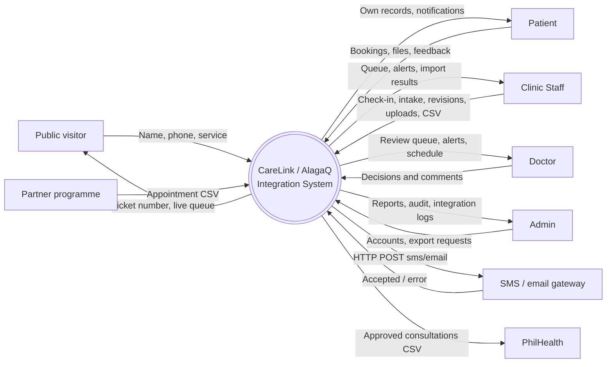

### 6.3 Data-Flow Diagram

Level-1 DFD (processes P1–P7, data stores D1–D7):

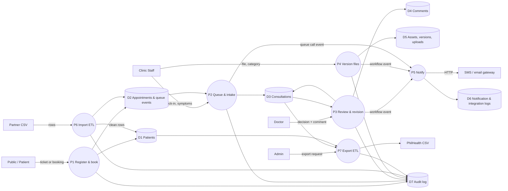

### 6.4 Sequence Diagram

Consultation submission, revision request, resubmission, approval, and patient notification:

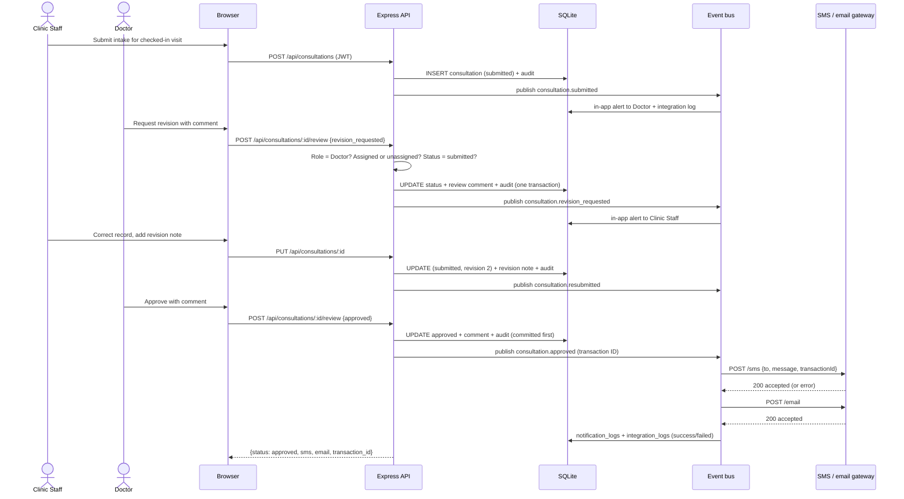

### 6.5 Database Design

```mermaid
erDiagram
  patients ||--o{ appointments : "books"
  patients ||--o{ consultations : "has"
  patients ||--o{ assets : "owns"
  patients ||--o| users : "linked patient account"
  patients ||--o{ notification_logs : "receives"
  users ||--o{ appointments : "doctor / created_by"
  users ||--o{ consultations : "submitted_by / reviewed_by"
  users ||--o{ asset_versions : "uploaded_by / reviewed_by"
  users ||--o{ comments : "writes"
  users ||--o{ audit_logs : "acts"
  appointments ||--o| consultations : "has one intake"
  appointments ||--o{ queue_events : "history"
  assets ||--|{ asset_versions : "versions"
  consultations ||--o{ comments : "thread (entity_type=consultation)"
  assets ||--o{ comments : "thread (entity_type=asset)"

  patients { int id PK; text mrn UK; text full_name; text date_of_birth; text phone; text email }
  users { int id PK; text username UK; text password_hash; text role; text display_name; int patient_id FK; int active }
  appointments { int id PK; int patient_id FK; int doctor_id FK; text scheduled_at; int queue_number; int queue_order; text reason; text status; int created_by FK }
  queue_events { int id PK; int appointment_id FK; text event_type; int actor_id FK; text details_json }
  consultations { int id PK; int appointment_id FK; int patient_id FK; int submitted_by FK; text symptoms; text clinical_notes; text status; int revision; text doctor_comment; int reviewed_by FK }
  assets { int id PK; int patient_id FK; int uploaded_by FK; text category; int current_version }
  asset_versions { int id PK; int asset_id FK; int version_number; text original_name; text storage_name UK; text status; int approved_by FK; text comment }
  comments { int id PK; text entity_type; int entity_id; int version_number; int author_id FK; text kind; text decision; text body }
  notification_logs { int id PK; int patient_id FK; text channel; text event_type; text destination; text status; text recipient_role; text transaction_id }
  integration_logs { int id PK; text transaction_id; text integration; text action; text status; text record_ref; text error_message }
  audit_logs { int id PK; int actor_id FK; text actor_role; text action; text entity_type; text entity_id; text details_json; text ip_address }
```

Key constraints (see [`server/schema.sql`](../server/schema.sql)):

| Table | Important constraints |
| --- | --- |
| `users` | Role limited to the four roles; a Patient account must link to a patient record |
| `appointments` | Status limited to booked, checked_in, in_consultation, completed, cancelled; unique ticket number per day |
| `consultations` | One consultation per appointment; status limited to draft, submitted, revision_requested, approved, rejected |
| `asset_versions` | Unique (asset, version); unique storage name; status limited to uploaded, revised, revision_requested, approved, rejected |
| `comments` | `entity_type` limited to consultation/asset; `kind` limited to comment, review, revision_note |
| `integration_logs` | Status limited to success, partial, failed; indexed by transaction ID |
| `audit_logs` | `BEFORE UPDATE` and `BEFORE DELETE` triggers abort with "audit logs are immutable" |

`server/src/setup.js` migrates older databases safely: it adds new columns with `ALTER TABLE` and rebuilds the two tables whose status lists grew using SQLite's documented create-copy-drop-rename procedure, then runs `PRAGMA foreign_key_check`.

### 6.6 User Interface Design

All screenshots were captured from the running prototype with seeded fictional data (`submission/screenshots/`).

| # | Required screen (spec §14) | CareLink screen | Screenshot |
| --- | --- | --- | --- |
| 1 | Login Page | `login.html` | 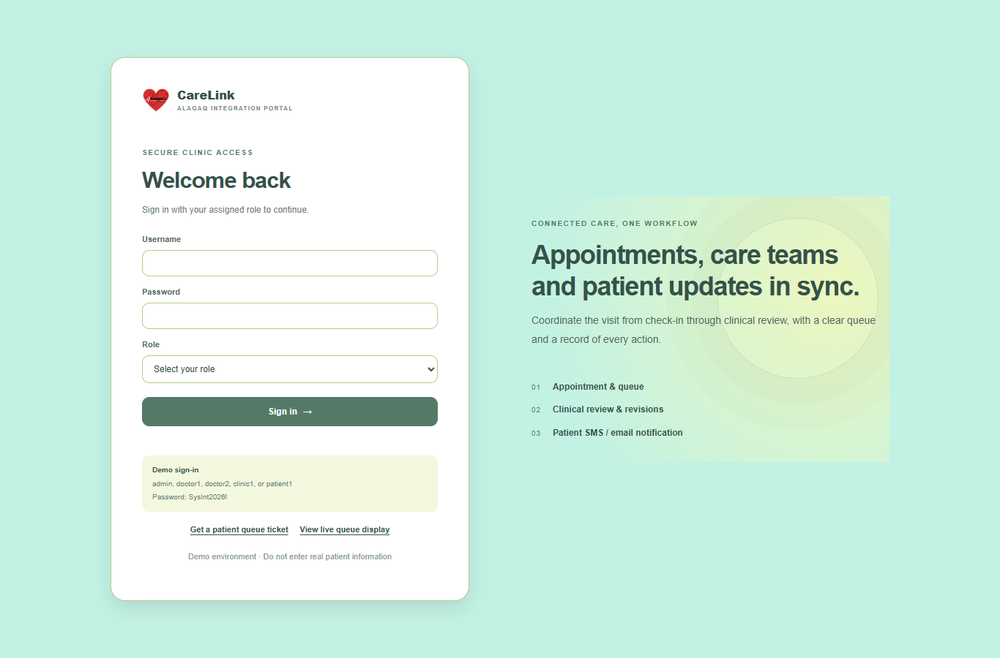 |
| 2 | Dashboard | `dashboard.html` (Admin and Doctor views) | 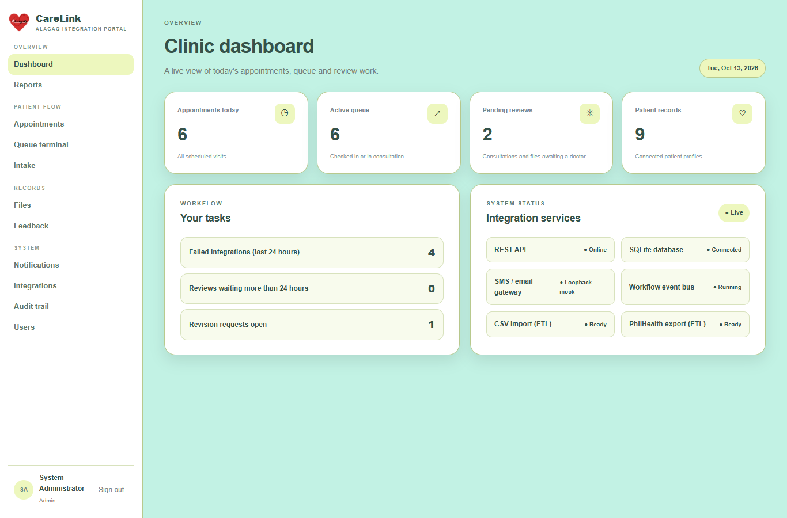 |
| 3 | Project List | `queue.html` — Appointments & doctor schedule | 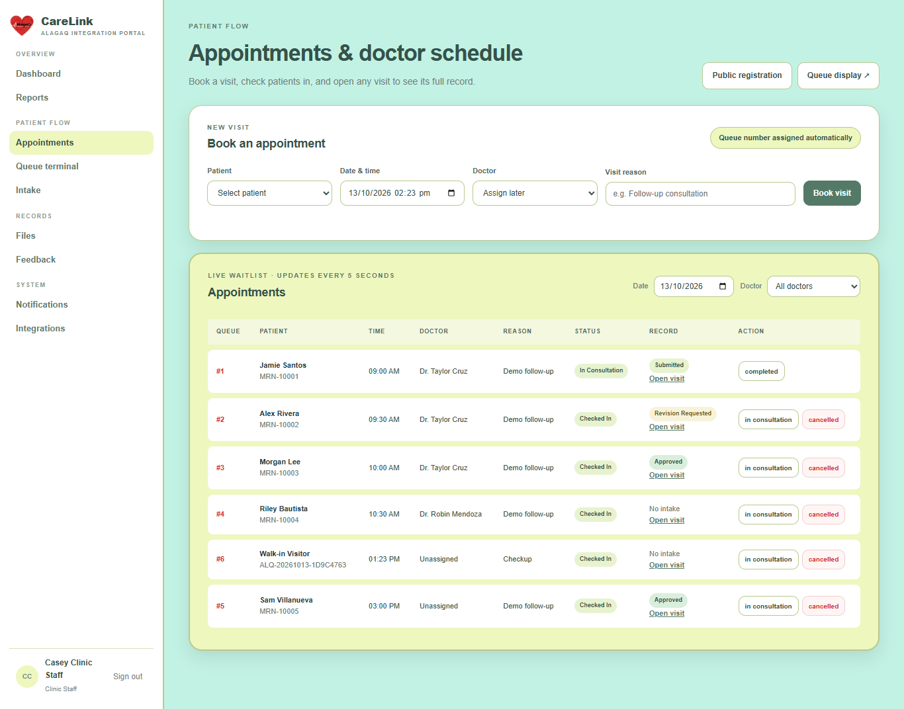 |
| 4 | Project Details | `appointment.html` — Visit details | 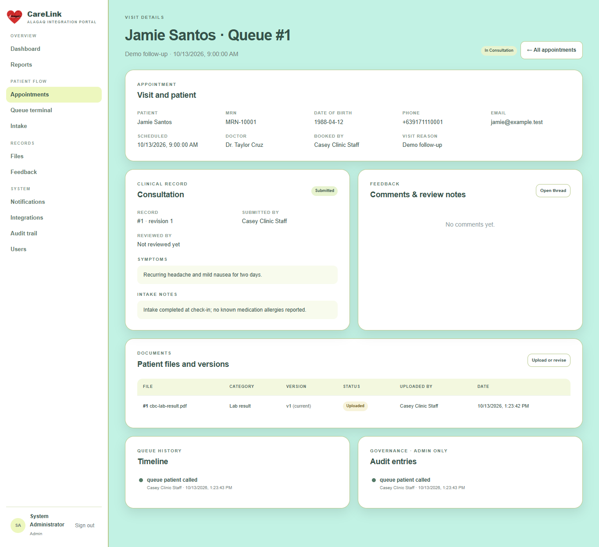 |
| 5 | Asset or Task Submission Form | `consultation.html` (intake) and `files.html` (upload) | 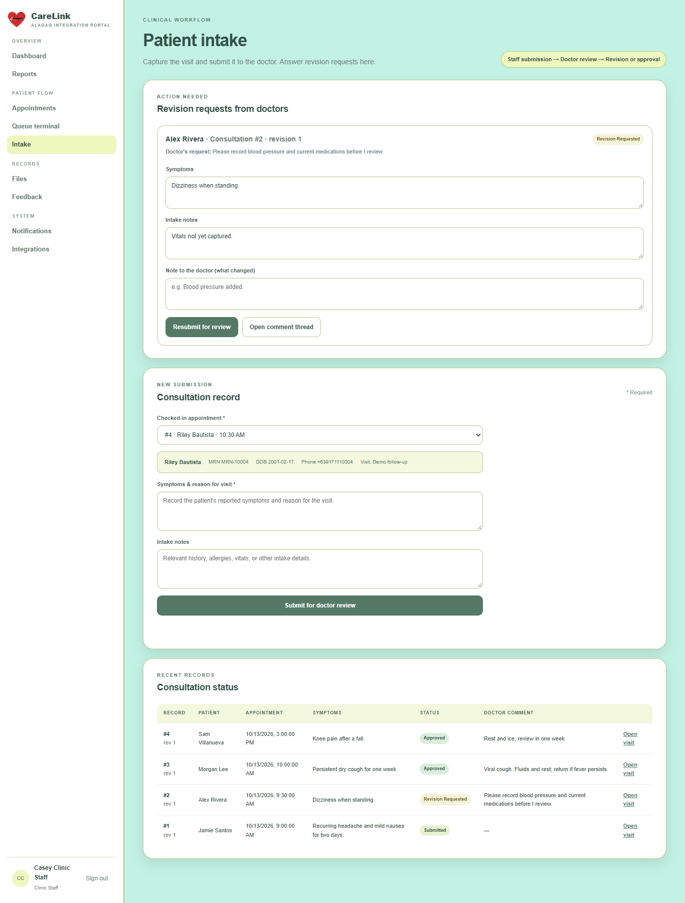 |
| 6 | Asset Version / Revision History | `files.html` — version history | 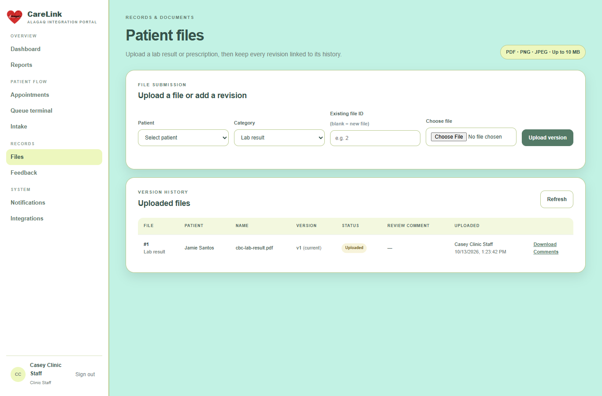 |
| 7 | Review and Approval Page | `approval.html` | 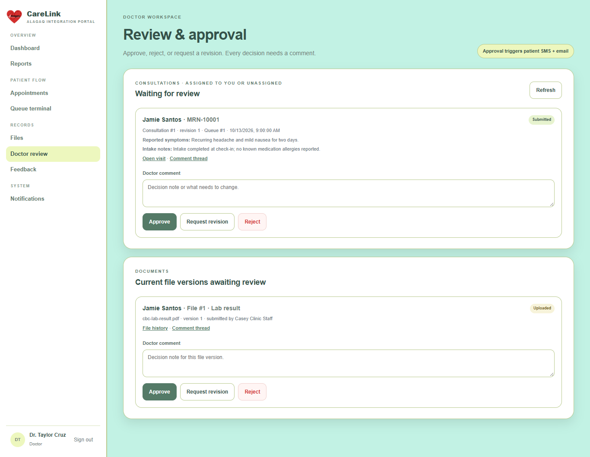 |
| 8 | Comment / Feedback Page | `comments.html` | 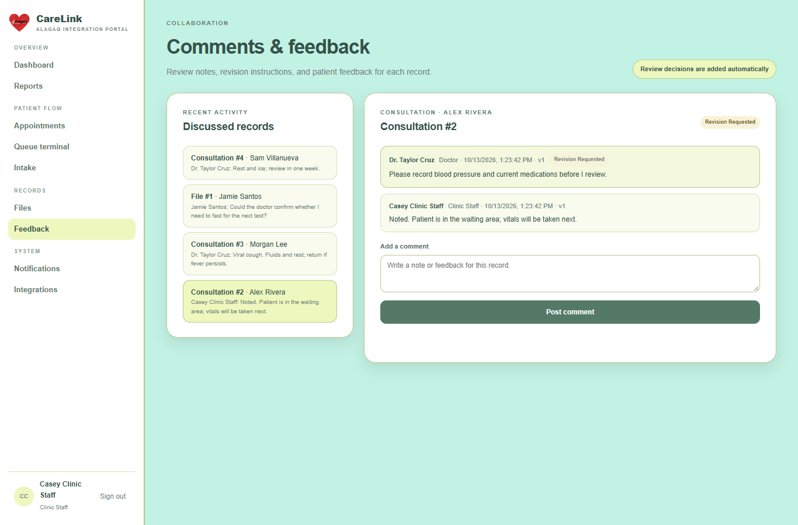 |
| 9 | Notification Log Page | `notifications.html` (Admin and Patient views) | 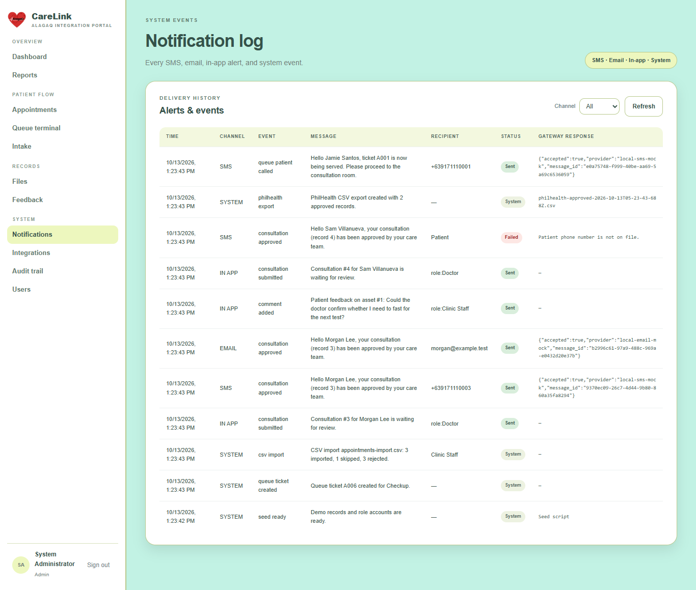 |
| 10 | Audit Log Page | `audit.html` | 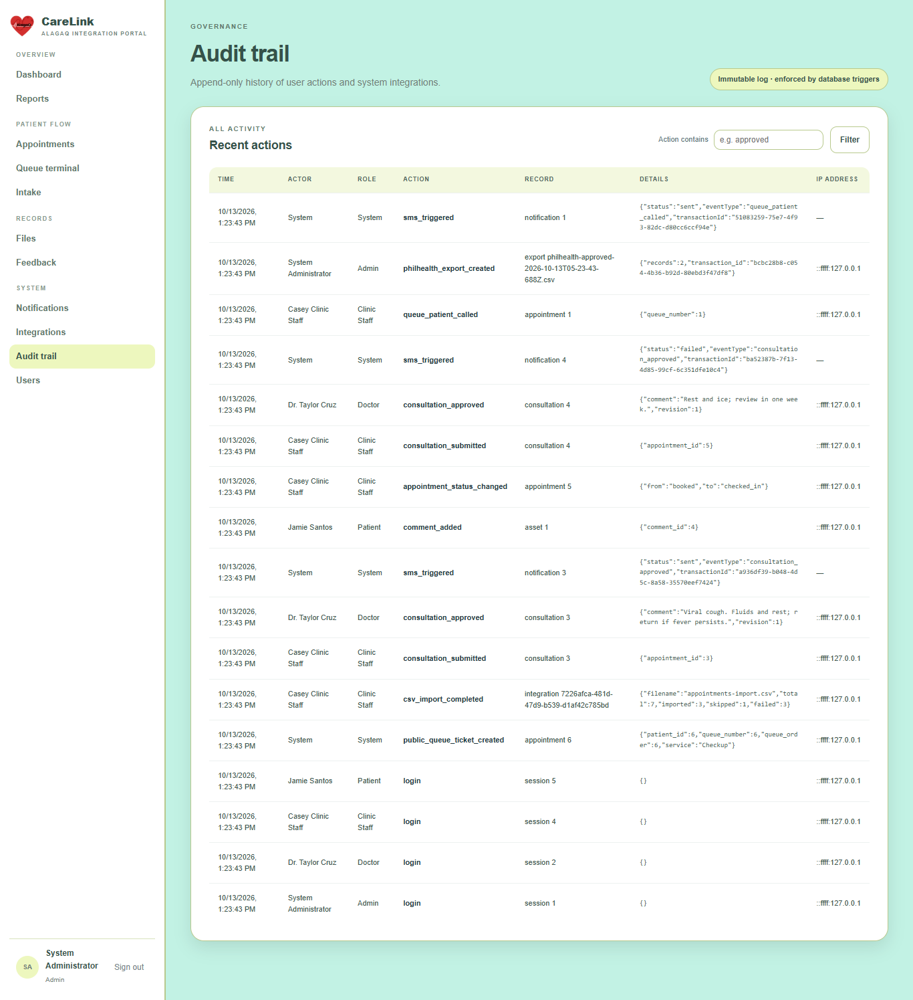 |
| 11 | Reports Page | `reports.html` | 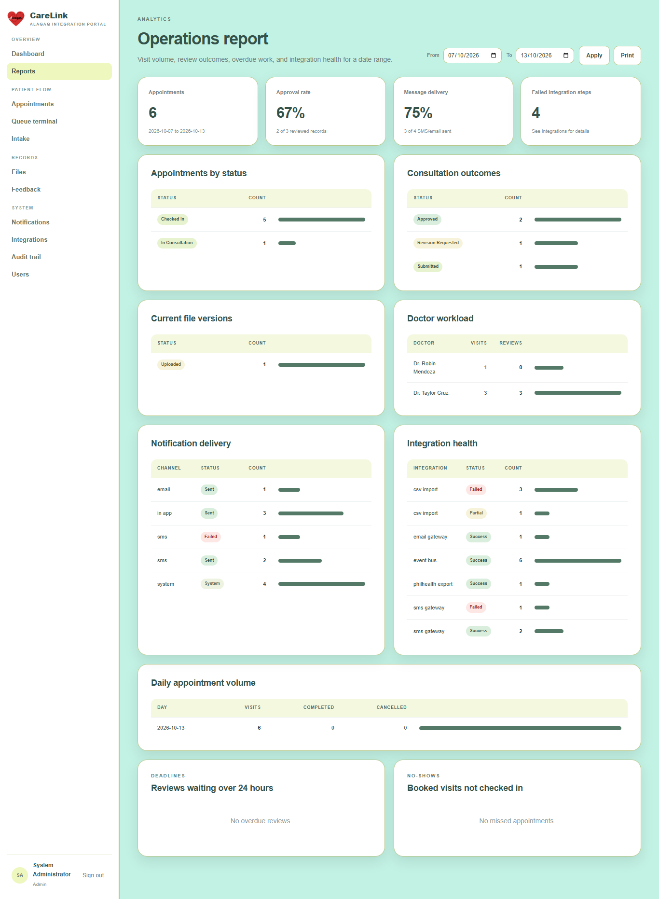 |
| 12 | User and Role Management | `users.html` | 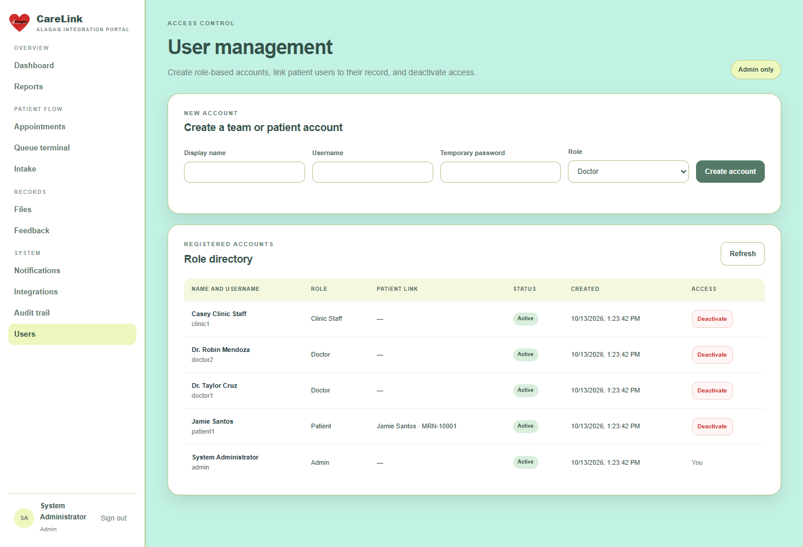 |

Supporting screens: Integrations (`13-integrations-log.png`), Queue terminal (`14-queue-terminal.png`), Doctor dashboard (`15-dashboard-doctor.png`), Patient notifications (`16-notifications-patient.png`), mobile public registration (`17-public-registration-mobile.png`), public queue display (`18-public-queue-display.png`), and the patient appointments view on a phone (`19-appointments-patient-mobile.png`).

Design notes: a fixed sidebar groups navigation into Overview, Patient flow, Records, and System, and shows only the links a role may use. On screens narrower than 960 px the sidebar becomes a top bar with horizontally scrolling links; below 760 px forms and grids stack into one column. Status is always shown as a labelled pill (never colour alone), and destructive actions (queue reset) ask for in-page confirmation.

---

## 7. Integration Design and Implementation

### 7.1 Integration Scenario

| ID | Integration | Systems / modules connected | Pattern | Option from spec §6 |
| --- | --- | --- | --- | --- |
| INT-01 | REST API | Browser and phone clients ↔ Express API ↔ SQLite | Request/response | API Integration |
| INT-02 | Workflow event bus | Route modules → bus → subscribers (in-app alerts, notifier) | Publish/subscribe | Messaging Simulation, Workflow Automation |
| INT-03 | SMS / email gateway | Notifier → external gateway over HTTP (loopback mock) | Point-to-point via adapter (webhook-style POST) | Webhook Simulation, external system |
| INT-04 | Appointment CSV import | Partner CSV → clean/validate → patients + appointments | Batch ETL | ETL Integration |
| INT-05 | PhilHealth export | Approved consultations → mapped CSV → export folder | Batch ETL | ETL / external-system integration |
| INT-06 | Automatic status changes | Upload → "uploaded/revised"; resubmit → "submitted"; queue next → "completed" + "in consultation" | Workflow automation | Workflow Automation |

### 7.2 API / ETL / Workflow / Webhook / Messaging Component

**Event bus** ([`server/src/services/eventBus.js`](../server/src/services/eventBus.js)) — every publish gets a transaction ID; the event and each subscriber failure are written to `integration_logs`; `publish` never throws, so a failed notification cannot undo a committed decision.

```js
async function publish(eventType, payload = {}) {
  const transactionId = crypto.randomUUID();
  const event = { type: eventType, payload, transactionId, occurredAt: new Date().toISOString() };
  const results = {};
  record({ action: eventType, status: 'success' });
  for (const { name, handler } of subscribers.get(eventType) || []) {
    try {
      results[name] = await handler(event);
    } catch (error) {
      results[name] = { status: 'failed', error: error.message };
      record({ action: `${eventType} -> ${name}`, status: 'failed', errorMessage: error.message });
    }
  }
  return { transactionId, results };
}
```

**Workflow subscribers** ([`server/src/services/workflowSubscribers.js`](../server/src/services/workflowSubscribers.js)) — the single list of "when X happens, tell Y":

| Event | Subscriber | Reaction |
| --- | --- | --- |
| `consultation.submitted`, `consultation.resubmitted` | doctorInbox | In-app alert to Doctor role |
| `asset.uploaded`, `asset.revised` | doctorInbox | In-app alert to Doctor role |
| `consultation.revision_requested`, `consultation.rejected` | staffInbox | In-app alert to Clinic Staff |
| `asset.revision_requested`, `asset.rejected` | staffInbox | In-app alert to Clinic Staff |
| `appointment.booked` | staffInbox | In-app alert to Clinic Staff |
| `comment.added` (by a patient) | staffInbox | In-app alert to Clinic Staff |
| `consultation.approved`, `asset.approved` | patientGateway | SMS + email to patient |
| `queue.patient_called` | patientGateway | SMS to patient (if a phone is on file) |

**REST API** — 38 endpoints; the full list is in Appendix B. Main integration endpoints:

| Method and path | Role | Purpose |
| --- | --- | --- |
| `POST /api/consultations/:id/review` | Doctor | Decision → event → SMS/email; returns `transaction_id` |
| `PUT /api/consultations/:id` | Admin, Clinic Staff | Resubmit after revision request |
| `POST /api/assets` / `POST /api/assets/:id/review` | Varies / Doctor | Versioned upload / file decision |
| `POST /api/integrations/appointments/import` | Admin, Clinic Staff | CSV import ETL |
| `POST /api/integrations/philhealth/export` | Admin | PhilHealth export ETL |
| `GET /api/integrations/logs?transaction_id=…` | Admin | Trace every step of one transaction |

**ETL pipelines** ([`server/src/routes/integrations.js`](../server/src/routes/integrations.js)):

- *Import* — **Extract**: parse RFC 4180 CSV (quoted fields, embedded commas, BOM). **Transform**: trim and collapse spaces, upper-case MRN, normalise `09…` phones to `+639…`, lower-case email, accept `YYYY-MM-DD HH:MM` or `MM/DD/YYYY H:MM`, validate every field, resolve `doctor_username`. **Load**: in one transaction, match an existing patient by MRN (or name + phone), skip duplicates already in the file or database, create patients when needed, allocate queue numbers, insert appointments. Per-row results are returned and every rejected row is logged.
- *Export* — **Extract** approved consultations joined to patient and appointment. **Transform** through a declarative field mapping (Section 7.3) with CSV quoting and formula-injection protection. **Load** to a temporary file renamed atomically into place, plus `latest.csv`.

### 7.3 Data Mapping Table

**CSV import → CareLink**

| Source column | Transformation | Target field | Rule if invalid |
| --- | --- | --- | --- |
| `patient_mrn` | Trim, upper-case; generated `IMP-YYYYMMDD-XXXXXX` if blank | `patients.mrn` | Reject row if characters other than A–Z, 0–9, `-` |
| `full_name` | Trim, collapse internal spaces | `patients.full_name` | Reject if missing or not 2–100 chars |
| `phone` | Remove spaces, dashes, brackets; `09xxxxxxxxx` → `+639xxxxxxxxx` | `patients.phone` | Reject if not 10–15 digits |
| `email` | Trim, lower-case | `patients.email` | Reject if not an email address |
| `scheduled_at` | `YYYY-MM-DD HH:MM`, `YYYY-MM-DDTHH:MM`, or `MM/DD/YYYY H:MM` → `YYYY-MM-DDTHH:MM` | `appointments.scheduled_at` | Reject if not a real calendar date/time |
| `reason` | Trim, collapse spaces | `appointments.reason` | Reject if missing or > 240 chars |
| `doctor_username` | Look up active Doctor account | `appointments.doctor_id` | Reject if the username is unknown |
| (derived) | Next number for that day | `appointments.queue_number`, `queue_order` | — |
| (derived) | Signed-in importer | `appointments.created_by` | — |
| (derived) | Same patient + same time exists | — | Skip row as duplicate |

**CareLink → PhilHealth demonstration CSV**

| Target column | Source |
| --- | --- |
| `consultation_id` | `consultations.id` |
| `patient_mrn` | `patients.mrn` |
| `patient_name` | `patients.full_name` |
| `date_of_birth` | `patients.date_of_birth` |
| `phone` | `patients.phone` |
| `appointment_datetime` | `appointments.scheduled_at` |
| `symptoms` | `consultations.symptoms` (latest revision) |
| `clinical_notes` | `consultations.clinical_notes` |
| `doctor_comment` | `consultations.doctor_comment` |
| `approved_at` | `consultations.reviewed_at` (UTC) |

**Workflow event → gateway request → logs**

| Event payload field | SMS/email request field | `notification_logs` | `integration_logs` |
| --- | --- | --- | --- |
| `patientId` → patient phone/email | `to` | `destination`, `patient_id` | `payload_json.to` |
| template + patient name | `message` | `message` | — |
| `type` (`consultation.approved`) | `eventType` (`consultation_approved`) | `event_type` | `action` |
| `recordId` | `recordId` | — | `record_ref` |
| `transactionId` | `transactionId` | `transaction_id` | `transaction_id` |
| gateway response / error | — | `status`, `response_body` | `status`, `error_message` |

### 7.4 Sample Payload or Data Format

All samples below were captured from the running prototype (`submission/evidence/api-evidence.json`).

**REST request and response — doctor approval**

```http
POST /api/consultations/3/review
Authorization: Bearer <JWT>
Content-Type: application/json

{ "decision": "approved", "comment": "Viral cough. Fluids and rest; return if fever persists." }
```

```json
{ "id": 3, "status": "approved", "sms": "sent", "email": "sent", "transaction_id": "a936df39-b048-4d5c-8a58-35570eef7424" }
```

**Workflow event (in-process message; shape produced by `eventBus.publish` for the same transaction)**

```json
{
  "type": "consultation.approved",
  "transactionId": "a936df39-b048-4d5c-8a58-35570eef7424",
  "occurredAt": "2026-10-13T05:23:43.…Z",
  "payload": { "recordId": 3, "recordRef": "consultation:3", "patientId": 3, "patientName": "Morgan Lee", "comment": "Viral cough. Fluids and rest; return if fever persists." }
}
```

**Gateway request and response (webhook-style POST to `/sms`; request body as built by `notifier.js`, response as stored in `notification_logs.response_body`)**

```json
{ "to": "+639171110003", "message": "Hello Morgan Lee, your consultation (record 3) has been approved by your care team.", "eventType": "consultation_approved", "recordId": 3, "transactionId": "a936df39-b048-4d5c-8a58-35570eef7424" }
```

```json
{ "accepted": true, "provider": "local-sms-mock", "message_id": "9370ec09-26c7-4d44-9b80-860a35fa8294" }
```

**CSV import input** ([`server/samples/appointments-import.csv`](../server/samples/appointments-import.csv)) and response

```csv
patient_mrn,full_name,phone,email,scheduled_at,reason,doctor_username
MRN-20001,  Dana   Cruz ,0917 222 0001,DANA@example.test,2026-12-01 09:00,Annual checkup,doctor1
MRN-20002,Lee Navarro,+639172220002,lee@example.test,12/01/2026 9:30,Vaccination - flu,doctor2
,Pat Ramos,0917-222-0003,,2026-12-01T10:00,"Follow-up, blood pressure",
MRN-20001,Dana Cruz,09172220001,dana@example.test,2026-12-01 09:00,Annual checkup,doctor1
MRN-20004,,0917 222 0004,,2026-12-01 10:30,Laboratory request,
MRN-20005,Jordan Tan,12345,jordan@invalid,2026-13-45 25:00,Consultation,
MRN-20006,Casey Uy,09172220006,casey@example.test,2026-12-01 11:00,Referral review,doctor9
```

```json
{
  "transaction_id": "7226afca-481d-47d9-b539-d1af42c785bd",
  "status": "partial", "total": 7, "imported": 3, "skipped": 1, "failed": 3,
  "rows": [
    { "row": 2, "status": "imported", "appointment_id": 7, "queue_number": 1 },
    { "row": 3, "status": "imported", "appointment_id": 8, "queue_number": 2 },
    { "row": 4, "status": "imported", "appointment_id": 9, "queue_number": 3 },
    { "row": 5, "status": "skipped", "message": "Duplicate of an earlier row in this file" },
    { "row": 6, "status": "failed", "message": "full_name is missing or not 2-100 characters" },
    { "row": 7, "status": "failed", "message": "phone is not a valid number; email is not valid; scheduled_at must be YYYY-MM-DD HH:MM or MM/DD/YYYY HH:MM" },
    { "row": 8, "status": "failed", "message": "Unknown doctor \"doctor9\"" }
  ]
}
```

Row 2 was cleaned to name `Dana Cruz`, phone `+639172220001`, email `dana@example.test`.

**PhilHealth export output** (`submission/evidence/philhealth-latest.csv`)

```csv
"consultation_id","patient_mrn","patient_name","date_of_birth","phone","appointment_datetime","symptoms","clinical_notes","doctor_comment","approved_at"
"3","MRN-10003","Morgan Lee","1993-07-24","+639171110003","2026-10-13T10:00","Persistent dry cough for one week.","Temp 37.4 °C. No known allergies.","Viral cough. Fluids and rest; return if fever persists.","2026-10-13 05:23:43"
```

### 7.5 Validation and Error Handling

| Case | Handling | HTTP status | Where it is recorded | Test |
| --- | --- | --- | --- | --- |
| Missing or expired token | Request refused | 401 | — | EH-01 |
| Wrong password or role | Generic "invalid username, password, or role" (no user enumeration) | 401 / 400 | — | EH-02 |
| Missing/invalid appointment fields, impossible date | Rejected before saving | 400 | — | EH-03 |
| Illegal status transition (e.g. booked → completed) | Rejected with allowed path in message | 409 | — | EH-03 |
| Duplicate intake for one appointment | Unique constraint → friendly message | 409 | — | EH-04 |
| Review of unknown / non-pending record, bad decision, empty comment | Rejected | 404 / 409 / 400 | — | EH-05 |
| Unsupported file type or > 10 MB | Upload refused; partial file deleted | 400 | — | EH-06 |
| Patient has no phone | Approval kept; SMS logged as **failed** with reason | 200 | notification + integration logs | EH-07 |
| Gateway down / non-2xx / timeout (5 s) | Same as above; error text stored | 200 | notification + integration logs | EH-07 (same path) |
| CSV missing required header column / empty / > 500 rows / bad quoting | Whole import refused | 400 / 413 | integration log (failed) | EH-08 |
| CSV row invalid | Row rejected with reasons; valid rows still load | 201 / 200 | integration log per row | IT-08 |
| CSV row duplicate (in file or in DB) | Row skipped | 201 / 200 | import summary | IT-08 |
| Resubmitting a record without a revision request | Rejected | 409 | — | EH-09 |
| Empty / overlong comment; unknown record | Rejected | 400 / 404 | — | EH-09 |
| Doctor reviews another doctor's patient | Refused | 403 | — | SC-05 |
| Any unexpected server error | Logged on server; generic message to client | 500 | server console | — |

### 7.6 Integration Logs

Successful transaction (one approval fanned out to three integration steps):

| Time (UTC) | Transaction ID | Integration | Action | Record | Status | Error |
| --- | --- | --- | --- | --- | --- | --- |
| 2026-10-13 05:23:43 | a936df39… | event_bus | consultation.approved | consultation:3 | success | — |
| 2026-10-13 05:23:43 | a936df39… | sms_gateway | consultation_approved | 3 | success | — |
| 2026-10-13 05:23:43 | a936df39… | email_gateway | consultation_approved | 3 | success | — |

Failed transactions:

| Time (UTC) | Transaction ID | Integration | Action | Record | Status | Error |
| --- | --- | --- | --- | --- | --- | --- |
| 2026-10-13 05:23:43 | ba52387b… | event_bus | consultation.approved | consultation:4 | success | — |
| 2026-10-13 05:23:43 | ba52387b… | sms_gateway | consultation_approved | 4 | **failed** | Patient phone number is not on file. |
| 2026-10-13 05:23:43 | 7226afca… | csv_import | appointments_import | appointments-import.csv | partial | 3 row(s) rejected |
| 2026-10-13 05:23:43 | 7226afca… | csv_import | row_rejected | appointments-import.csv#row6 | **failed** | full_name is missing or not 2-100 characters |
| 2026-10-13 05:23:43 | 7226afca… | csv_import | row_rejected | appointments-import.csv#row7 | **failed** | phone is not a valid number; email is not valid; scheduled_at must be YYYY-MM-DD HH:MM or MM/DD/YYYY HH:MM |
| 2026-10-13 05:23:43 | 7226afca… | csv_import | row_rejected | appointments-import.csv#row8 | **failed** | Unknown doctor "doctor9" |

The Integrations page (screenshot 13) lists these rows; clicking a transaction ID filters to every step of that transaction.

---

## 8. Security, Governance, and Risk Management

### 8.1 Role-Based Access Control Matrix

Legend: **All** = every record; **Own** = only the patient's linked record; **Assigned** = visits assigned to that doctor or unassigned; **—** = denied (HTTP 403).

| Resource / action | Admin | Doctor | Clinic Staff | Patient | Public |
| --- | --- | --- | --- | --- | --- |
| Request queue ticket / view display | ✓ | ✓ | ✓ | ✓ | ✓ |
| Dashboard | All | All | All | Own | — |
| Users: list, create, activate/deactivate | All | — | — | — | — |
| Patient directory | All | All | All | Own | — |
| Appointments: view | All | All | All | Own | — |
| Appointments: book | All | — | All | Own (patient ID forced) | — |
| Appointment status changes | All | All | All | — | — |
| Visit details | All (+ audit) | Assigned | All | Own | — |
| Queue terminal: next / skip / recall | ✓ | ✓ | ✓ | — | — |
| Queue reset | ✓ | — | — | — | — |
| Intake submit / resubmit | ✓ | — | ✓ | — | — |
| Consultations: view | All | Assigned | All | Own | — |
| Consultation decision | — | Assigned | — | — | — |
| Files: upload, list, download | All | All | All | Own | — |
| File decision | — | ✓ | — | — | — |
| Comments: read / write | All | Assigned | All | Own | — |
| Notifications | All | Doctor inbox | Staff inbox | Own SMS/email | — |
| Reports | ✓ | ✓ | ✓ | — | — |
| CSV import | ✓ | — | ✓ | — | — |
| PhilHealth export, integration logs | ✓ | — | — | — | — |
| Audit trail | ✓ | — | — | — | — |

The browser hides links a role cannot use, but the API enforces every rule independently (`allow(...)` role guard plus `lib/access.js` record checks). Security tests SC-01 to SC-07 verify the denials.

### 8.2 Least Privilege and Separation of Duties

- **Least privilege.** Each role receives only the actions its job needs. Patients are confined to their own patient ID on every read and write (the server overrides any patient ID a patient sends). Doctors see consultations assigned to them or unassigned, not other doctors' patients. Clinic staff cannot see integration logs or the audit trail. The public endpoints expose ticket numbers and services, never names.
- **Separation of duties.** Staff prepare records; only doctors decide on them. Admins manage accounts, exports, and audit, but **cannot approve clinical records**. Nobody can edit or delete audit rows, including admins through the API. An admin cannot deactivate their own account (prevents lock-out and self-concealment).
- **Immediate revocation.** Every request reloads the user from the database, so a deactivated account loses access on its next request even with an unexpired token (SC-07).

### 8.3 Data Privacy and Protection

Controls applied in the prototype, aligned with the principles of the Philippine Data Privacy Act of 2012 (RA 10173) — transparency, legitimate purpose, and proportionality:

| Data | Protection |
| --- | --- |
| Passwords | bcrypt hashes (cost 10); never returned by the API |
| Sessions | Signed JWT (8 h); server refuses to start in production without a custom `JWT_SECRET` |
| Patient records | Role + record-level checks; public display shows ticket numbers only |
| SMS / email content | Templates contain name, record number, and status only — no symptoms or diagnosis |
| Uploaded files | Random storage names (no user-controlled paths), type allow-list, 10 MB limit, authenticated download with audit |
| Exports | Admin-only; formula-injection-safe CSV |
| Transport | HTTP headers hardened with Helmet; TLS must be provided by a reverse proxy in production |
| Test / demo data | Fictional names, `.test` email domain; spec reminder #7 respected |
| Backups | Contain personal data; must be encrypted and access-controlled in production (Section 10.3) |

### 8.4 Audit Trail

Sample rows from `audit_logs` (newest first), captured from the prototype:

| Time (UTC) | Actor | Role | Action | Record | Details |
| --- | --- | --- | --- | --- | --- |
| 05:23:43 | System Administrator | Admin | philhealth_export_created | export philhealth-approved-…csv | records 2, transaction bcbc28b8… |
| 05:23:43 | Casey Clinic Staff | Clinic Staff | queue_patient_called | appointment 1 | queue_number 1 |
| 05:23:43 | System | System | sms_triggered | notification 4 | status failed, consultation_approved |
| 05:23:43 | Dr. Taylor Cruz | Doctor | consultation_approved | consultation 4 | comment, revision 1 |
| 05:23:43 | Casey Clinic Staff | Clinic Staff | consultation_submitted | consultation 4 | appointment 5 |
| 05:23:43 | Casey Clinic Staff | Clinic Staff | appointment_status_changed | appointment 5 | booked → checked_in |
| 05:23:43 | Jamie Santos | Patient | comment_added | asset 1 | comment 4 |
| 05:23:43 | Casey Clinic Staff | Clinic Staff | csv_import_completed | integration 7226afca… | 7 total, 3 imported, 1 skipped, 3 failed |
| 05:23:43 | System | System | public_queue_ticket_created | appointment 6 | queue 6, Checkup |
| 05:23:43 | Dr. Taylor Cruz | Doctor | login | session 2 | — |

Audited actions include: login, user created/activated/deactivated, appointment booked/status changed, queue called/completed/skipped/recalled/reset, consultation submitted/approved/rejected/revision requested/resubmitted, asset uploaded/revised/approved/rejected/revision requested/downloaded, comment added, CSV import completed, PhilHealth export created, and every SMS trigger. Each row stores actor, role, IP address, timestamp, and JSON details. The audit table is protected by `BEFORE UPDATE` / `BEFORE DELETE` triggers (SC-04).

### 8.5 Integration Ownership and Governance

| Data type / module | Business owner | Technical owner (team role) | Source of truth | Change control |
| --- | --- | --- | --- | --- |
| User accounts and roles | Clinic administrator | Backend / Integration Developer | `users` | Admin screen only; every change audited |
| Patient identity | Front-desk supervisor | Backend / Integration Developer | `patients` | Created by ticket, booking, or import; MRN unique |
| Appointments and queue | Front-desk supervisor | Backend / Integration Developer | `appointments`, `queue_events` | Allowed transitions enforced in code |
| Consultations and reviews | Medical director | Backend / Integration Developer | `consultations`, `comments` | Only doctors decide; revisions numbered |
| Patient files | Medical records officer | Backend / Integration Developer | `asset_versions` + `uploads/` | Versions never overwritten |
| Notification templates and channels | Clinic administrator + DPO | Backend / Integration Developer | `workflowSubscribers.js` | Content reviewed for privacy before change |
| CSV import layout | Front-desk supervisor | Backend / Integration Developer | Import mapping (§7.3) | Header change requires code + test update |
| PhilHealth export layout | Clinic administrator (claims) | Backend / Integration Developer | Export mapping (§7.3) | Must follow the official PhilHealth specification |
| Integration and audit logs | Clinic administrator / DPO | QA / Security Lead | `integration_logs`, `audit_logs` | Append-only; reviewed weekly |
| Backups | Clinic administrator | QA / Security Lead | `backups/` folders + manifest | Restore tested each release |

### 8.6 Risk Register

Likelihood and impact: 1 (low) – 3 (high). Risk level = likelihood × impact (1–2 Low, 3–4 Medium, 6–9 High).

| ID | Risk | L | I | Level | Control (implemented) | Monitoring plan |
| --- | --- | --- | --- | --- | --- | --- |
| R-01 | Default JWT secret used outside the demo | 2 | 3 | High (6) | Server refuses to start in production without `JWT_SECRET`; documented | Deployment checklist sign-off each release |
| R-02 | Patient health details leak through SMS/email | 2 | 3 | High (6) | Templates limited to name, record number, status | DPO reviews template changes; spot-check notification log monthly |
| R-03 | Gateway outage leaves patients uninformed | 2 | 2 | Medium (4) | Failures logged with reason; approval unaffected; dashboard shows failed integrations (24 h) | Admin reviews failed-integration count daily |
| R-04 | PhilHealth layout differs from the official specification | 3 | 3 | High (9) | Export labelled "demonstration"; mapping is declarative and tested | Validate against official spec before go-live; reconcile each submission |
| R-05 | Malicious or mislabelled upload | 2 | 3 | High (6) | Extension allow-list, 10 MB limit, random storage names, authenticated download | Add MIME/magic-byte check and malware scan (§12.2); review upload audit weekly |
| R-06 | Public ticket endpoint flooded with fake tickets | 2 | 2 | Medium (4) | Field validation, fixed service list, daily reset | Watch ticket counts in reports; add rate limiting/CAPTCHA if abused |
| R-07 | Backup copies exposed or lost | 2 | 3 | High (6) | Integrity-checked snapshots with manifest; previous data retained on restore | Monthly restore drill; encrypt and store offsite in production |
| R-08 | Privileged user tampers with audit history | 1 | 3 | Medium (3) | SQLite triggers block update/delete | Export audit log to write-once storage; compare counts weekly |
| R-09 | Unauthorized access to another patient's records | 1 | 3 | Medium (3) | Role guard + record-level checks; tests SC-03, SC-05, SC-06 | Run security tests on every change; review 403s in logs |
| R-10 | Bad CSV corrupts appointment data | 2 | 2 | Medium (4) | Per-row validation, duplicate detection, transactional load, per-row log | Review import summaries; keep source files |
| R-11 | Concurrent edits cause duplicate decisions or events | 1 | 2 | Low (2) | Status checks inside transactions; unique constraints | Add idempotency keys in production; monitor duplicate notifications |
| R-12 | Assumed current-state process is inaccurate | 2 | 2 | Medium (4) | Labelled as baseline in §2.1 | Validate with a clinic stakeholder before the defense |
| R-13 | Single server / SQLite failure stops the clinic | 2 | 3 | High (6) | Backup/restore tooling; recovery plan with RTO/RPO | Health endpoint check; daily backup verification |

---

## 9. Testing and Evaluation

### 9.1 Test Plan

| Item | Approach |
| --- | --- |
| Scope | Functional behaviour, module-to-module and system-to-gateway integration, validation and error paths, access control, one full end-to-end workflow, backup and restore |
| Tooling | Node.js built-in test runner (`node:test`), `fetch` against a real server process, `better-sqlite3` for database assertions |
| Isolation | Each run creates a temporary database, upload and export folders, picks free ports, runs `setup` and `seed`, starts the API and gateway, and deletes everything afterwards; the demo database is never touched |
| Data | Seeded fictional patients and accounts plus fixtures created by the tests |
| Command | From `server/`: `npm test` (or `node --test --test-reporter=spec`) |
| Pass criteria | All tests pass; minimum counts in spec §16 met |
| Manual / UI | Headless-browser walk-through of all 19 screens for console errors (0 found) and screenshot capture |
| Evidence | `submission/test-results.txt`, `submission/screenshots/`, `submission/evidence/` |

### 9.2 Functional Test Cases

| ID | Scenario | Expected result | Result |
| --- | --- | --- | --- |
| FT-01 | Health endpoint and every page load with shared styles | 200 OK; ≥ 12 screens load a stylesheet | Pass |
| FT-02 | Staff retrieve active doctor directory | Seeded doctor listed | Pass |
| FT-03 | Public visitor requests a ticket | 201; ticket `A###`; queue position ≥ 1 | Pass |
| FT-04 | Dashboard metrics for a signed-in role | API online, DB connected, integer counts | Pass |
| FT-05 | Patient books while sending another patient's ID | Booking saved under the patient's own ID; queue number allocated | Pass |
| FT-06 | Staff submit intake for a checked-in visit | 201 `submitted`; visible in doctor's queue | Pass |
| FT-07 | Patient downloads own file | 200; file bytes returned | Pass |
| FT-08 | Doctor approves current file version with comment | `approved`; SMS `sent` | Pass |
| FT-09 | Doctor rejects consultation with comment | `rejected`; no SMS; comment stored | Pass |
| FT-10 | Doctor rejects a file version | `rejected`; no SMS; comment stored | Pass |
| FT-11 | Doctor requests revision; staff resubmit | `revision_requested` → `submitted`, revision 2; thread shows review + revision note | Pass |
| FT-12 | File revision requested; next version uploaded and approved | v2 `revised` then `approved` | Pass |
| FT-13 | Patient comments on own file; staff read thread | Comment stored with author role; patient sees only own threads | Pass |
| FT-14 | Visit details aggregate everything | Appointment, consultation, comments, files, queue events, audit | Pass |
| FT-15 | Reports for staff; invalid date range | All sections returned; reversed range → 400 | Pass |

### 9.3 Integration Test Cases

| ID | Data exchange tested | Expected result | Result |
| --- | --- | --- | --- |
| IT-01 | Four roles authenticate (API ↔ SQLite ↔ bcrypt/JWT) | Tokens issued for each role | Pass |
| IT-02 | Check-in → appointment, queue terminal, public display | All three reflect the change | Pass |
| IT-03 | Doctor approval → event bus → SMS gateway → notification + audit logs | SMS `sent`; `consultation_approved` notification; `sms_triggered` audit | Pass |
| IT-04 | Multipart upload → disk + `asset_versions` | File on disk; v1 and v2 rows | Pass |
| IT-05 | Approved records → PhilHealth CSV → download | File + `latest.csv`; header and MRN present | Pass |
| IT-06 | One approval → event bus + SMS + email under one transaction ID | Exactly `event_bus`, `sms_gateway`, `email_gateway`, all success | Pass |
| IT-07 | Workflow events → role inboxes | Doctor sees submissions; staff see revision requests; patient sees only own deliveries | Pass |
| IT-08 | Sample CSV → clean → load; re-import | 3 imported, 1 skipped, 3 rejected (`partial`); cleaned values; 3 failed row logs; re-import skips 4 | Pass |
| IT-09 | Queue "call next" → event → SMS | `queue_patient_called` SMS logged as sent | Pass |

### 9.4 Error-Handling Test Cases

| ID | Invalid input / failure | Expected result | Result |
| --- | --- | --- | --- |
| EH-01 | No bearer token | 401 | Pass |
| EH-02 | Wrong password; invalid role | 401; 400 | Pass |
| EH-03 | Booking without time; booked → completed | 400; 409 | Pass |
| EH-04 | Second intake for the same visit | 409 | Pass |
| EH-05 | Review unknown record; blank comment; invalid decision; file approval without comment | 404; 400; 400; 400 | Pass |
| EH-06 | Upload `.exe` | 400 | Pass |
| EH-07 | Approve for patient without phone | Approval kept; SMS `failed` with reason in integration log | Pass |
| EH-08 | CSV missing required columns | 400 naming the columns; failed integration log | Pass |
| EH-09 | Resubmit when no revision requested; empty comment; comment on unknown record | 409; 400; 404 | Pass |

**Security and access-control test cases**

| ID | Attempt | Expected result | Result |
| --- | --- | --- | --- |
| SC-01 | Patient/doctor open admin-only audit and users | 403 | Pass |
| SC-02 | Patient submits intake or creates a Doctor account | 403 | Pass |
| SC-03 | Patient downloads another patient's file | 403 | Pass |
| SC-04 | Direct SQL UPDATE/DELETE on audit rows | Aborted: "audit logs are immutable" | Pass |
| SC-05 | Doctor 2 reviews a consultation assigned to Doctor 1 | 403; not in Doctor 2's list | Pass |
| SC-06 | Patient opens another patient's visit, thread, or posts a comment; patient opens reports; staff open integration logs | All 403 | Pass |
| SC-07 | Deactivate an account with a live session | Existing token → 401; new sign-in → 401 | Pass |

### 9.5 End-to-End Test Scenario

**E2E-01 — from booking to final approval and export** (automated; also the live demo path in Section 11.1):

| Step | Actor | Action | Expected system response |
| --- | --- | --- | --- |
| 1 | Clinic Staff | Book appointment for MRN-10003 with Dr. Taylor Cruz | 201, queue number allocated; `appointment.booked` event |
| 2 | Clinic Staff | Check the patient in | Status `checked_in`; queue event recorded |
| 3 | Clinic Staff | Submit intake ("Cough for one week", no vitals) | Consultation `submitted`; doctor alerted |
| 4 | Doctor | Request revision: "Please add temperature." | `revision_requested`; staff alerted |
| 5 | Clinic Staff | Resubmit with "Temp 37.4 C." and a revision note | `submitted`, revision 2; doctor alerted |
| 6 | Doctor | Approve with comment | `approved`; SMS `sent`; email `sent` |
| 7 | Admin | Generate PhilHealth export | CSV contains the revised notes |
| 8 | Admin | Check notifications and audit | `consultation_approved` SMS; audit has submitted → revision_requested → resubmitted → approved |

Result: **Pass**.

### 9.6 Test Results Summary

| Test type | Required (spec §16) | Executed | Passed | Failed |
| --- | ---: | ---: | ---: | ---: |
| Functional | 8 | 15 | 15 | 0 |
| Integration | 5 | 9 | 9 | 0 |
| Error handling | 5 | 9 | 9 | 0 |
| Security / access control | 3 | 7 | 7 | 0 |
| End-to-end | 1 | 1 | 1 | 0 |
| Backup / recovery (additional) | — | 2 | 2 | 0 |
| **Total** | **22** | **43** | **43** | **0** |

Full output: [`submission/test-results.txt`](test-results.txt). The browser walk-through rendered all 19 screens with **zero console errors**.

---

## 10. Deployment, Backup, and Recovery

### 10.1 Deployment Environment

| Item | Demonstration environment |
| --- | --- |
| Host | One Windows 11 workstation (also runs on macOS/Linux) |
| Runtime | Node.js ≥ 18.17 (verified on 24.13.1), npm |
| Web/API | Express on port 3000 (`PORT`) |
| Gateway mock | Express on 127.0.0.1:5051 (`SMS_GATEWAY_PORT`), loopback only |
| Database | `server/data/healthcare.sqlite` (`DB_FILE`) |
| File storage | `server/uploads/` (`UPLOAD_DIR`), `server/exports/philhealth/` (`EXPORT_DIR`) |
| Clients | Any modern browser on the LAN; phones for AlagaQ registration/display |

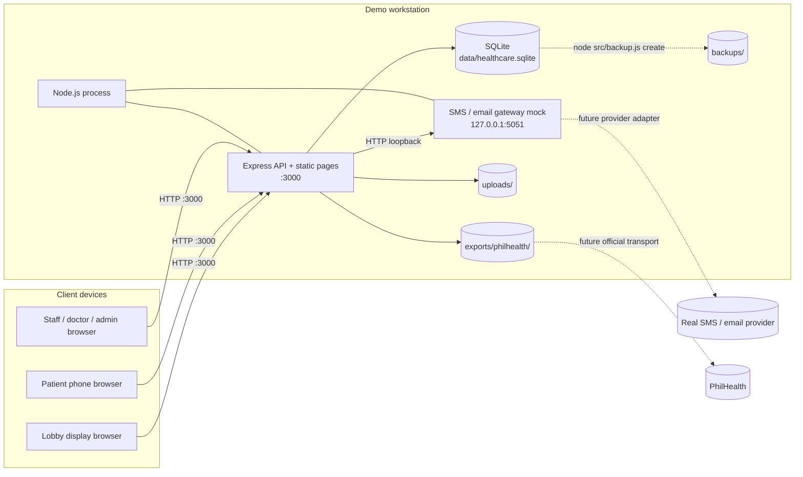

**Production notes:** place the app behind a TLS reverse proxy, set `NODE_ENV=production` and a long random `JWT_SECRET`, replace the gateway mock with a provider adapter, and schedule backups.

### 10.2 Deployment Evidence

- Running prototype screenshots: `submission/screenshots/01-login.png` to `19-appointments-patient-mobile.png` (Section 6.6).
- Health endpoint: `GET http://localhost:3000/api/health` → `{ "ok": true, "service": "healthcare-integration-api", "time": "…" }`.
- Server console on start:

  ```text
  Local SMS/email gateway listening on 127.0.0.1:5051
  Healthcare system listening at http://localhost:3000
  ```

- Integration evidence: `submission/evidence/api-evidence.json` (requests, responses, integration log, notifications, audit rows, unauthorized responses) and `philhealth-latest.csv`.

### 10.3 Backup Plan

| Asset | Method | Frequency (recommended) | Retention | Location |
| --- | --- | --- | --- | --- |
| Database | `node src/backup.js create` — SQLite online backup API (consistent while running) + `integrity_check` + manifest | Daily, and before every upgrade | 30 daily, 12 monthly | `server/backups/<timestamp>/`, copied offsite |
| Uploaded files | Copied by the same command | Daily | Same as database | Same folder |
| PhilHealth exports | Copied by the same command | Daily | Same as database | Same folder |
| Source code | Git repository with remote | Every change | Full history | Remote Git host |
| Documentation and evidence | Stored in `submission/` in the repository | Every change | Full history | Remote Git host |

Backups contain personal data; in production they must be encrypted at rest, access-controlled, and copied to a second location.

### 10.4 Recovery Plan

| Step | Action |
| --- | --- |
| 1 | Stop the application (no process may hold the database open). |
| 2 | Choose the most recent backup whose `manifest.json` shows `integrity_check: ok`. |
| 3 | Run `node src/backup.js restore <backup-folder>`. The script re-checks integrity, stages the copy, swaps it in, and keeps the previous database and folders with a `.pre-restore-<timestamp>` suffix. If any step fails it rolls back automatically. |
| 4 | Start the application and open `/api/health`; sign in and confirm recent records. |
| 5 | Record the incident and restore time; re-enter any changes made after the backup from paper notes. |

Targets for the demo clinic: **RPO 24 hours** (daily backup) and **RTO 30 minutes**.

Evidence (`submission/evidence/backup-restore-log.txt`, isolated demo database):

```text
$ node src/backup.js create <backup-dir>
Backup created: <scratch>/backup-demo
  manifest: integrity_check "ok", patient_records 9, includes healthcare.sqlite, uploads/, exports/philhealth/

# Simulated failure: the live database file is deleted
patients before failure: 9
ls: cannot access '<demo>/demo.sqlite': No such file or directory

$ node src/backup.js restore <backup-dir>
Backup restored to <demo>/demo.sqlite
Previous runtime folder retained at <demo>/uploads.pre-restore-2026-10-13T05-24-53-890Z
Previous runtime folder retained at <demo>/exports.pre-restore-2026-10-13T05-24-53-890Z
patients after restore: 9 | approved consultations: 2 | integrity_check: ok
```

Automated tests BR-01 and BR-02 repeat backup and restore on every test run.

---

## 11. System Demonstration Guide

### 11.1 Demo Script

Before the demo: `cd server`, `npm install`, `npm run setup`, `npm run seed`, `npm start`; open `http://localhost:3000`. Keep the public display open on a second screen.

| # | Presentation step | Who | What to do and show |
| --- | --- | --- | --- |
| 1 | Public registration (mobile) | Visitor | Open `register.html` on a phone, get a ticket; show it appear on `display.html` |
| 2 | CSV import (ETL) | `clinic1` | Integrations → import `server/samples/appointments-import.csv`; show 3 imported / 1 skipped / 3 rejected with reasons |
| 3 | Queue | `clinic1` | Queue terminal → Call next; display updates; Notifications (as admin) show the queue SMS |
| 4 | Intake | `clinic1` | Intake → submit a record for a checked-in visit |
| 5 | Doctor alert + revision | `doctor1` | Dashboard task count; Notifications inbox; Doctor review → **Request revision** with comment |
| 6 | Resubmission | `clinic1` | Intake → "Revision requests" panel → correct and resubmit; open Feedback thread |
| 7 | Approval + SMS/email | `doctor1` | Approve; toast shows "SMS sent, email sent" |
| 8 | Files and versions | `clinic1` / `doctor1` | Upload a PDF; doctor requests revision; upload v2 with "Upload revision"; doctor approves (final) |
| 9 | Traceability | `admin` | Integrations → click the approval's transaction ID → event bus + SMS + email rows; show a failed row |
| 10 | Export | `admin` | Generate PhilHealth CSV; download `latest.csv` |
| 11 | Governance | `admin` | Audit trail filtered by "approved"; Reports; Users → deactivate a test account |
| 12 | Security | `patient1` | Show limited navigation; attempt `/audit.html` → redirected; API returns 403 |
| 13 | Backup | terminal | `node src/backup.js create`; show manifest |

### 11.2 Demo Accounts

All demo accounts use the password **`SysInt2026!`** (demonstration only).

| Username | Role | Notes |
| --- | --- | --- |
| `admin` | Admin | Full management access |
| `doctor1` | Doctor | Dr. Taylor Cruz — assigned to the first three seeded visits |
| `doctor2` | Doctor | Dr. Robin Mendoza — shows assignment scoping (cannot review Dr. Cruz's patients) |
| `clinic1` | Clinic Staff | Casey Clinic Staff |
| `patient1` | Patient | Linked to Jamie Santos (MRN-10001) |

### 11.3 Sample Data

Created by `npm run seed` (idempotent; safe to re-run):

| Data | Sample |
| --- | --- |
| Patients | MRN-10001 Jamie Santos, MRN-10002 Alex Rivera, MRN-10003 Morgan Lee, MRN-10004 Riley Bautista, MRN-10005 Sam Villanueva (no phone/email — demonstrates failed SMS) |
| Today's visits | Queue #1–#3 with Dr. Cruz (checked in), #4 with Dr. Mendoza (checked in), #5 unassigned at 15:00 (booked) |
| Consultations | #1 Jamie Santos — submitted, awaiting review; #2 Alex Rivera — revision requested with doctor comment and a staff reply |
| Files | File #1 `cbc-lab-result.pdf` (Lab result, v1, uploaded) for Jamie Santos |
| CSV sample | `server/samples/appointments-import.csv` — 3 valid rows, 1 duplicate, 3 invalid rows |
| Logs | `seed_ready` system notification; audit and integration logs fill as the demo runs |

---

## 12. Limitations and Future Enhancements

### 12.1 System Limitations

1. SMS and email go to a loopback mock; no carrier or mail provider delivers messages.
2. The PhilHealth CSV layout is illustrative, not the official PhilHealth specification, and is written to a folder rather than transmitted.
3. Events are processed in memory; if the process stops mid-delivery the event is not retried (no durable queue or outbox).
4. Failed notifications are logged but not automatically retried.
5. Single server with SQLite: no horizontal scaling or high availability.
6. Uploads are checked by extension and size only — no content (magic-byte) validation or malware scanning.
7. The public ticket endpoint has no rate limiting or CAPTCHA.
8. No password reset or self-service profile editing; accounts cannot be renamed.
9. Queue displays poll every 2–5 seconds instead of receiving push updates.
10. The current-state process is an analytical baseline, not an observed study.

### 12.2 Recommended Enhancements

1. **Real provider adapters** for SMS (e.g., a local aggregator) and email, with delivery-receipt webhooks.
2. **Durable messaging**: an outbox table or message broker with retry, back-off, and a dead-letter view on the Integrations page.
3. **Official PhilHealth integration** once the current data dictionary and transport are obtained, with acknowledgment and reconciliation.
4. **Cloud storage integration** for patient files (object storage with signed URLs) and malware scanning.
5. **Push updates** (WebSockets / Server-Sent Events) for the queue display and inboxes.
6. **Native or PWA patient app** with offline ticket and push notifications.
7. **Doctor schedule management** (working hours, slot capacity, online slot booking).
8. **Analytics**: average wait time, consultation duration, no-show trends, exportable reports.
9. **Security hardening**: rate limiting, MFA for admins and doctors, password reset, external tamper-evident audit storage.
10. **Managed database** (PostgreSQL) and containerised deployment for multi-clinic use.

---

## 13. Individual Contribution

Replace the placeholders with each member's real name and verified work. Suggested role split follows spec §17.

| Member name | Role | Specific contribution |
| --- | --- | --- |
| [[Member 1]] | Project Manager / Systems Analyst | [[e.g., problem statement, current/target process models, requirements and traceability matrix, ADRs]] |
| [[Member 2]] | UI/UX and Multimedia Lead | [[e.g., design system (`app.css`), sidebar layout, page templates, mobile registration and display, screenshots]] |
| [[Member 3]] | Backend / Integration Developer | [[e.g., schema and migrations, REST API routes, event bus and notifier, CSV import and PhilHealth export ETL]] |
| [[Member 4]] | QA / Security Lead | [[e.g., RBAC matrix and record-level access, automated test suite, risk register, backup/restore testing, log review]] |
| [[Member 5]] | Documentation and Presenter | [[e.g., final report, diagrams, demo script, slides, defense preparation]] |

---

## 14. References

1. National University – College of Computing and Information Technologies. *Final Project Specification: Systems Integration and Architecture, Mobile and Web Application Track.*
2. Express.js. *Express 4.x API Reference — Router.* https://expressjs.com/en/4x/api.html#router
3. Node.js. *Test runner (`node:test`) documentation.* https://nodejs.org/api/test.html
4. SQLite. *The SQLite Online Backup API.* https://www.sqlite.org/backup.html
5. SQLite. *ALTER TABLE — Making Other Kinds of Table Schema Changes.* https://www.sqlite.org/lang_altertable.html
6. SQLite. *CREATE TRIGGER.* https://www.sqlite.org/lang_createtrigger.html
7. OWASP. *Authorization Cheat Sheet.* https://cheatsheetseries.owasp.org/cheatsheets/Authorization_Cheat_Sheet.html
8. OWASP. *CSV Injection.* https://owasp.org/www-community/attacks/CSV_Injection
9. IETF. *RFC 4180: Common Format and MIME Type for Comma-Separated Values (CSV) Files.* https://www.rfc-editor.org/rfc/rfc4180
10. IETF. *RFC 7519: JSON Web Token (JWT).* https://www.rfc-editor.org/rfc/rfc7519
11. Hohpe, G., & Woolf, B. (2003). *Enterprise Integration Patterns.* Addison-Wesley.
12. Nygard, M. (2011). *Documenting Architecture Decisions.* https://cognitect.com/blog/2011/11/15/documenting-architecture-decisions
13. Republic of the Philippines. *Republic Act No. 10173 — Data Privacy Act of 2012.* https://privacy.gov.ph/data-privacy-act/
14. Mermaid. *Diagram syntax documentation.* https://mermaid.js.org/

---

## 15. Appendices

### Appendix A — Source Layout

```text
public/                     Browser pages (HTML) and assets
  assets/app.css            Shared design system
  assets/app.js             Shared core: API client, helpers, sidebar, page registry
  assets/pages/*.js         One script per portal page
  assets/queue-*.js         Public registration and display scripts
  manifest.webmanifest      Installable AlagaQ web app
server/
  schema.sql                Database schema, constraints, audit triggers
  samples/                  Sample CSV for the import demo
  src/index.js              App wiring: middleware, routers, event bus, gateway mock
  src/setup.js / seed.js    Schema setup + migrations / demo data
  src/backup.js             Backup and restore tool
  src/lib/                  clinic (dates, queue numbers), access (record rules), csv
  src/services/             eventBus, notifier, workflowSubscribers
  src/routes/               accounts, appointments, queue, consultations, assets,
                            comments, reports, integrations, system
  test/system.test.js       43 automated tests
submission/                 Report, slides outline, test results, screenshots, evidence
```

### Appendix B — API Endpoint Reference

| Method | Path | Roles |
| --- | --- | --- |
| GET | `/api/health` | Public |
| POST | `/api/public/tickets` | Public |
| GET | `/api/public/queue-display` | Public |
| POST | `/api/auth/login` | Public |
| GET | `/api/auth/me` | Signed in |
| GET / POST | `/api/users` | Admin |
| PATCH | `/api/users/:id/status` | Admin |
| GET | `/api/doctors`, `/api/patients`, `/api/dashboard` | Signed in (patients scoped) |
| GET / POST | `/api/appointments` | Signed in / Admin, Staff, Patient |
| GET | `/api/appointments/:id` | Signed in (scoped) |
| PATCH | `/api/appointments/:id/status` | Admin, Staff, Doctor |
| GET | `/api/queue/control` | Admin, Doctor, Staff |
| POST | `/api/queue/control/next`, `/skip`, `/recall` | Admin, Doctor, Staff |
| POST | `/api/queue/control/reset` | Admin |
| GET / POST | `/api/consultations` | Signed in (scoped) / Admin, Staff |
| PUT | `/api/consultations/:id` | Admin, Staff |
| POST | `/api/consultations/:id/review` | Doctor (assigned) |
| GET / POST | `/api/assets` | Signed in (scoped) |
| POST | `/api/assets/:id/review`, `/api/assets/:id/approve` | Doctor |
| GET | `/api/assets/:id/download/:version` | Signed in (scoped) |
| GET / POST | `/api/comments` | Signed in (scoped) |
| GET | `/api/notifications` | Signed in (role inbox) |
| GET | `/api/audit` | Admin |
| GET | `/api/reports` | Admin, Doctor, Staff |
| POST | `/api/integrations/appointments/import` | Admin, Staff |
| POST | `/api/integrations/philhealth/export` | Admin |
| GET | `/api/integrations/philhealth/latest` | Admin |
| GET | `/api/integrations/logs` | Admin |

### Appendix C — Environment Variables

| Variable | Default | Purpose |
| --- | --- | --- |
| `PORT` | 3000 | Web/API port |
| `SMS_GATEWAY_PORT` | 5051 | Gateway mock port |
| `SMS_GATEWAY_URL` | `http://127.0.0.1:<port>/sms` | SMS endpoint |
| `EMAIL_GATEWAY_URL` | `http://127.0.0.1:<port>/email` | Email endpoint |
| `JWT_SECRET` | development value | Token signing secret (required in production) |
| `NODE_ENV` | — | `production` enforces `JWT_SECRET` |
| `DB_FILE` | `server/data/healthcare.sqlite` | Database path |
| `UPLOAD_DIR` | `server/uploads` | Uploaded files |
| `EXPORT_DIR` | `server/exports/philhealth` | PhilHealth exports |

### Appendix D — Evidence Files

| File | Contents |
| --- | --- |
| `submission/test-results.txt` | Full output of the 43-test run |
| `submission/screenshots/*.png` | 19 screenshots of the running prototype |
| `submission/evidence/api-evidence.json` | Captured requests/responses, integration log, notifications, audit rows, 401/403 responses |
| `submission/evidence/philhealth-latest.csv` | Sample PhilHealth export |
| `submission/evidence/backup-restore-log.txt` | Backup, simulated failure, and restore transcript |
